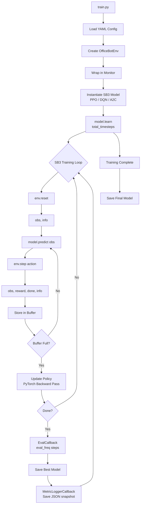
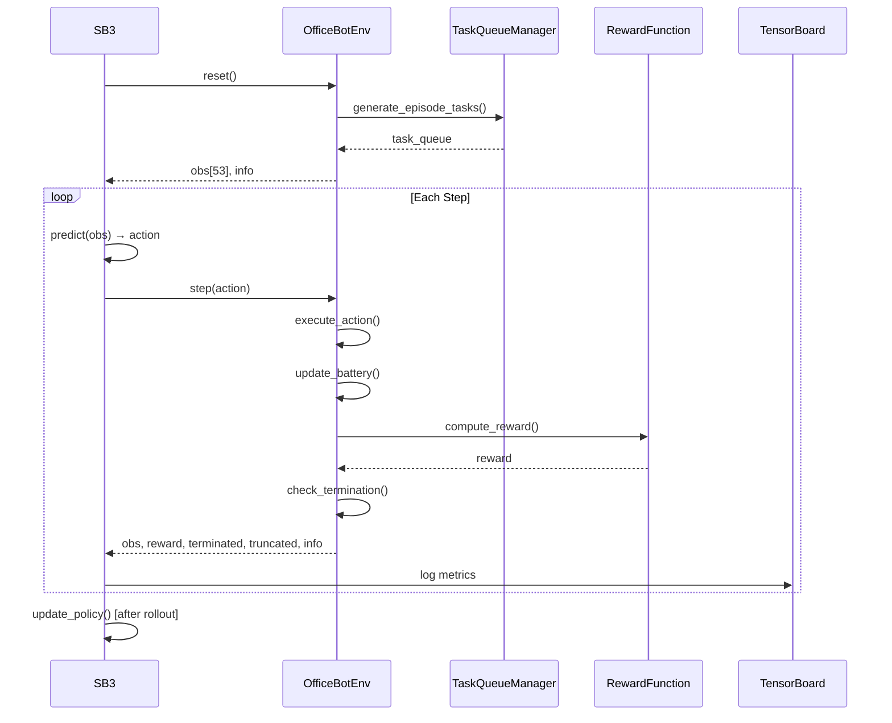
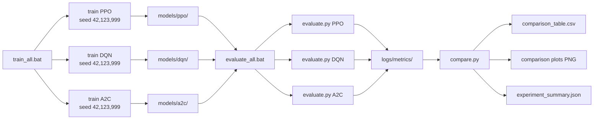

# OFFICEBOT_RL_PROJECT_SPEC.md
# OfficeBot RL: A Multi-Task Autonomous Office Assistant
### Using Stable-Baselines3, MiniGrid, and Gymnasium
### Complete Technical Specification & Implementation Blueprint

---

> **Purpose of This Document**
> This file is the single authoritative source of truth for building the OfficeBot RL project.
> It is written to be read by Claude Code (Opus) from top to bottom so that the entire project
> can be independently implemented without further clarification. Every technology choice, file
> location, class name, reward value, command, and test expectation is specified here.
> Prioritise **reliability**, **simplicity**, **free/open-source tooling**, and **local Windows
> execution** over any form of unnecessary complexity.

---

## Table of Contents

1. [Project Overview & Problem Statement](#1-project-overview--problem-statement)
2. [Objectives & Use Cases](#2-objectives--use-cases)
3. [Technology Stack & Rationale](#3-technology-stack--rationale)
4. [System Architecture](#4-system-architecture)
5. [Office Environment Design](#5-office-environment-design)
6. [Observation & Action Spaces](#6-observation--action-spaces)
7. [Task System](#7-task-system)
8. [Reward Function](#8-reward-function)
9. [RL Algorithms: PPO, DQN, A2C](#9-rl-algorithms-ppo-dqn-a2c)
10. [Training Strategy](#10-training-strategy)
11. [Evaluation Metrics](#11-evaluation-metrics)
12. [Visualization & Final Demo](#12-visualization--final-demo)
13. [Complete Folder Structure](#13-complete-folder-structure)
14. [Dependencies, Setup & Windows Commands](#14-dependencies-setup--windows-commands)
15. [Configuration Files](#15-configuration-files)
16. [Phased Development Plan](#16-phased-development-plan)
17. [Pseudocode & Implementation Guidance](#17-pseudocode--implementation-guidance)
18. [Error Handling & Troubleshooting](#18-error-handling--troubleshooting)
19. [Testing Strategy](#19-testing-strategy)
20. [Git & GitHub Workflow](#20-git--github-workflow)
21. [Final Deliverables & README Requirements](#21-final-deliverables--readme-requirements)
22. [Architecture & Data-Flow Diagrams](#22-architecture--data-flow-diagrams)

---

## 1. Project Overview & Problem Statement

### 1.1 Project Title
**OfficeBot RL: A Multi-Task Autonomous Office Assistant**

### 1.2 Course Context
This is a **Reinforcement Learning course project** demonstrating how a simulated robot agent can
learn to perform multiple structured office tasks inside a grid-world environment using
state-of-the-art deep RL algorithms.

### 1.3 Problem Statement
In a modern office, routine tasks—delivering coffee, routing documents, visiting meeting rooms,
managing battery charge, and avoiding obstacles—are repetitive and time-consuming. A reinforcement
learning agent trained in a simulated environment can learn an optimal policy for sequencing and
executing these tasks without hand-coded rules, purely from reward signals.

The challenge is to:
- Design a grid-world office environment that is **complex enough** to be a meaningful RL problem.
- Train an agent using multiple RL algorithms under **identical conditions**.
- **Empirically compare** PPO, DQN, and A2C without assuming any one algorithm is better.
- Produce a **live demo** where a human observer can watch the trained agent work.

### 1.4 Why This Is a Real RL Problem
- The agent must **plan sequences** of actions to complete tasks in a specific order.
- **Battery management** introduces a resource constraint that forces the agent to balance
  task completion against survival.
- **Obstacle avoidance** creates spatial credit assignment challenges.
- Multiple simultaneous tasks create a **task prioritisation** sub-problem.
- The environment can be made **stochastic** (randomised layouts, dynamic obstacles) to test
  generalisation.

### 1.5 Expected Final Demo
Running `python run_demo.py --algo ppo` loads a trained PPO model and opens a rendered window
(Matplotlib or PyGame) showing:
- The 2D office grid with rooms, walls, desks, and special objects.
- The OfficeBot's current position and facing direction.
- A live sidebar or terminal overlay showing: **current task**, **battery level**, **cumulative
  reward**, **collision count**, **completed tasks**, **failed tasks**, and **step number**.
- The agent navigating autonomously, picking up and delivering items, visiting targets, and
  returning to charge when battery is low.

---

## 2. Objectives & Use Cases

### 2.1 Academic Objectives
1. Implement a **custom Gymnasium-compatible environment** on top of MiniGrid.
2. Train and compare **three RL algorithms** (PPO, DQN, A2C) using Stable-Baselines3.
3. Generate **quantitative evaluation metrics** (mean reward, success rate, collision rate, etc.).
4. Produce **publication-quality plots** and logs for a final project report.
5. Demonstrate that RL can solve a **multi-task sequential decision problem**.

### 2.2 Technical Objectives
- Build everything with **free, open-source tools** that run **locally on a student Windows laptop**.
- Every experiment must be **fully reproducible** from a fixed random seed.
- The codebase must be **modular**: swapping one algorithm for another requires only a config change.
- All training must complete in **reasonable time** on a CPU-only laptop (≤ 2–4 hours per run).

### 2.3 Use Cases the Agent Demonstrates
| # | Task Name | Description |
|---|-----------|-------------|
| 1 | Coffee Delivery | Navigate from start → coffee machine → target desk |
| 2 | Document Delivery | Navigate from start → printer → target desk |
| 3 | Meeting Room Visit | Navigate to meeting room and stay for 1 step |
| 4 | Battery Recharge | Navigate to charging station when battery is low |
| 5 | Obstacle Avoidance | Navigate around walls and furniture without collision |

---

## 3. Technology Stack & Rationale

### 3.1 Technology Map

| Technology | Role | Why This Choice |
|------------|------|-----------------|
| **Python 3.10** | Primary language | Stable, widely supported by all RL libraries |
| **MiniGrid** | Simulated office grid world | Free, lightweight, fully customisable grid environments |
| **Gymnasium** | RL environment interface standard | Industry-standard `reset()`/`step()`/`render()` API |
| **Stable-Baselines3 (SB3)** | RL algorithm implementations | Production-quality PPO, DQN, A2C; integrates with Gymnasium |
| **PyTorch** | Deep learning backend for SB3 | SB3 uses PyTorch internally for neural networks |
| **Matplotlib** | Plotting training curves and metrics | Free, local, no server required |
| **TensorBoard** | Real-time training monitoring | Free, local, SB3 has built-in TensorBoard callback support |
| **YAML** | Algorithm configuration files | Human-readable, no code changes needed to tweak hyperparams |
| **pytest** | Unit and integration testing | Standard Python testing framework |
| **Streamlit** *(optional)* | Demo dashboard UI | Free, local; use **only if** it simplifies the demo |
| **Git** | Version control | Required for reproducibility and submission |

### 3.2 How the Technologies Interact

```
┌─────────────────────────────────────────────────────────┐
│                    Training Script                       │
│  training/train.py                                       │
│  - Reads YAML config                                     │
│  - Instantiates SB3 algorithm                            │
│  - Passes OfficeBotEnv (Gymnasium) to SB3                │
└───────────┬─────────────────────────────────────────────┘
            │ env = OfficeBotEnv(...)
            ▼
┌─────────────────────────────────────────────────────────┐
│              OfficeBotEnv (environment/env.py)           │
│  Subclasses MiniGrid's MiniGridEnv                       │
│  Implements Gymnasium API:                               │
│    reset() → obs, info                                   │
│    step(action) → obs, reward, done, truncated, info     │
│    render() → visual frame                               │
│  Contains: grid layout, task queue, battery system       │
└───────────┬─────────────────────────────────────────────┘
            │ Uses MiniGrid grid primitives
            ▼
┌─────────────────────────────────────────────────────────┐
│              MiniGrid (minigrid library)                  │
│  Provides: Grid, Wall, Floor, Door, Goal objects         │
│  Provides: Agent direction encoding, FOV rendering       │
└───────────┬─────────────────────────────────────────────┘
            │ SB3 learns using PyTorch
            ▼
┌─────────────────────────────────────────────────────────┐
│         Stable-Baselines3 (PPO / DQN / A2C)             │
│  - PPO: on-policy, actor-critic, clip objective         │
│  - DQN: off-policy, Q-value, experience replay          │
│  - A2C: on-policy, actor-critic, synchronous            │
│  - All use PyTorch neural networks internally           │
│  - Callbacks → TensorBoard logs, model checkpoints      │
└───────────┬─────────────────────────────────────────────┘
            │
            ▼
┌─────────────────────────────────────────────────────────┐
│              Logging & Visualisation                      │
│  logs/tensorboard/{algo}/   ← TensorBoard events        │
│  logs/metrics/{algo}/       ← JSON metric files         │
│  results/plots/             ← Matplotlib PNG files      │
│  models/                    ← Saved .zip checkpoints    │
└─────────────────────────────────────────────────────────┘
```

### 3.3 What Is NOT Allowed
- No paid APIs (OpenAI, Anthropic, AWS, GCP, Azure).
- No proprietary software, commercial simulators, or paid datasets.
- No cloud compute (training must run fully local).
- No services that require an account with payment details.
- No API keys of any kind.

---

## 4. System Architecture

### 4.1 High-Level Component Diagram

```
officebot-rl/
│
├── environment/          ← Custom Gymnasium + MiniGrid environment
│   ├── env.py            ← OfficeBotEnv class (CORE)
│   ├── tasks.py          ← Task definitions and task queue manager
│   ├── objects.py        ← Custom MiniGrid world objects (coffee, printer…)
│   └── wrappers.py       ← Gymnasium observation/action wrappers
│
├── agents/               ← Algorithm selection and instantiation
│   └── agent_factory.py  ← Returns configured SB3 model given algo name + config
│
├── training/             ← Training entry points
│   ├── train.py          ← Main training script
│   └── callbacks.py      ← SB3 callbacks (checkpoint, eval, metric logging)
│
├── evaluation/           ← Evaluation scripts
│   ├── evaluate.py       ← Runs trained model, collects metrics
│   └── compare.py        ← Loads all three algo results and compares
│
├── visualization/        ← Plotting and demo rendering
│   ├── plot_results.py   ← Generates Matplotlib figures
│   └── render_env.py     ← Environment rendering utilities
│
├── configs/              ← YAML configuration files
│   ├── ppo_config.yaml
│   ├── dqn_config.yaml
│   ├── a2c_config.yaml
│   └── env_config.yaml
│
├── models/               ← Saved model checkpoints (.zip files)
├── logs/                 ← TensorBoard events + raw metric JSON
├── results/              ← Final plots and experiment result tables
├── tests/                ← pytest unit and integration tests
├── scripts/              ← Helper shell/bat scripts
├── docs/                 ← Report figures, architecture diagrams
│
├── run_demo.py           ← Main demo entry point
├── requirements.txt
├── pyproject.toml        ← Optional: for packaging
├── .gitignore
└── README.md
```

### 4.2 Data Flow Through One Training Step

```
1. SB3 calls env.reset()
   → OfficeBotEnv initialises grid, places agent, generates task queue
   → Returns observation dict (flattened grid + task + battery)

2. SB3 samples action from policy network (PyTorch)

3. SB3 calls env.step(action)
   → OfficeBotEnv executes action (move/turn/interact)
   → Checks collisions, task progress, battery depletion
   → Computes reward from reward function
   → Checks episode termination conditions
   → Returns (obs, reward, terminated, truncated, info)

4. SB3 stores transition in buffer (rollout for PPO/A2C, replay buffer for DQN)

5. After buffer is full (PPO/A2C) or after update_frequency (DQN):
   → SB3 computes loss using PyTorch
   → Updates policy network weights
   → Logs to TensorBoard

6. EvalCallback runs every eval_freq steps:
   → Runs agent on fixed eval env (no randomisation)
   → Saves best model if mean reward improved

7. Every checkpoint_freq steps:
   → MetricLoggerCallback saves JSON snapshot of metrics
   → CheckpointCallback saves .zip model file
```

---

## 5. Office Environment Design

### 5.1 Grid Size
Use a **15 × 15 grid** (including outer walls). This is large enough to require meaningful
navigation but small enough to train in reasonable time on a CPU laptop.

The outer walls are always present (MiniGrid default). Inner layout uses the 13 × 13 interior.

### 5.2 Office Layout (Fixed MVP Layout)

```
  0  1  2  3  4  5  6  7  8  9 10 11 12 13 14
0 W  W  W  W  W  W  W  W  W  W  W  W  W  W  W
1 W  .  .  .  W  .  .  .  W  .  .  .  .  .  W
2 W  .  D1 .  W  .  CO .  W  .  .  .  .  .  W
3 W  .  .  .  .  .  .  .  W  .  M  .  .  .  W
4 W  .  .  .  W  .  .  .  W  .  .  .  .  .  W
5 W  W  .  W  W  W  .  W  W  W  W  W  W  W  W
6 W  .  .  .  .  .  .  .  .  .  .  .  .  .  W
7 W  .  P  .  .  .  .  .  .  .  D2 .  .  .  W
8 W  .  .  .  .  .  .  .  .  .  .  .  .  .  W
9 W  W  .  W  W  W  .  W  W  W  W  W  .  W  W
10 W .  .  .  .  .  .  .  .  .  .  .  .  .  W
11 W .  CH .  .  .  .  .  .  .  D3 .  MT .  W
12 W .  .  .  .  .  .  .  .  .  .  .  .  .  W
13 W .  .  .  A  .  .  .  .  .  .  .  .  .  W
14 W  W  W  W  W  W  W  W  W  W  W  W  W  W  W

Legend:
  W  = Wall
  .  = Empty floor
  D1 = Desk 1 (delivery target)
  D2 = Desk 2 (delivery target)
  D3 = Desk 3 (delivery target)
  CO = Coffee Machine
  P  = Printer
  M  = Meeting Room (3×3 area, rows 3-4, cols 9-13)
  CH = Charging Station
  MT = Meeting Table (inside meeting room, visual only)
  A  = Agent starting position (row 13, col 4)
```

**Key design decisions:**
- The office is divided into two halves by horizontal corridors at rows 5 and 9.
- Movement between halves requires passing through corridor openings (col 2 and col 6).
- This forces the agent to navigate through bottlenecks, making path planning non-trivial.
- The charging station (CH) is in the bottom-left; the agent must detour there when battery is low.

### 5.3 Room Definitions

| Room ID | Name | Cells (approx) | Contains |
|---------|------|-----------------|----------|
| R1 | Top-Left Office | rows 1-4, cols 1-3 | Desk 1 |
| R2 | Top-Middle Office | rows 1-4, cols 5-7 | Coffee Machine |
| R3 | Top-Right Area | rows 1-4, cols 9-13 | Meeting Room, Meeting Table |
| R4 | Corridor | row 5-6, all cols | Open passage |
| R5 | Middle-Left | rows 6-8, cols 1-3 | Printer |
| R6 | Middle-Right | rows 6-8, cols 9-13 | Desk 2 |
| R7 | Corridor 2 | rows 9-10, all cols | Open passage |
| R8 | Bottom-Left | rows 10-13, cols 1-4 | Charging Station |
| R9 | Bottom-Right | rows 10-13, cols 9-12 | Desk 3 |

### 5.4 Objects and Their MiniGrid Encoding

All custom objects extend MiniGrid's `WorldObj`. Define them in `environment/objects.py`.

```python
# environment/objects.py

from minigrid.core.world_object import WorldObj
from minigrid.core.constants import COLOR_NAMES

class CoffeeMachine(WorldObj):
    """Pickup point for coffee delivery tasks."""
    def __init__(self):
        super().__init__('coffee_machine', 'yellow')
    def can_overlap(self): return False
    def can_pickup(self): return False
    def encode(self): return (10, 0, 0)   # custom type ID 10

class Printer(WorldObj):
    """Pickup point for document delivery tasks."""
    def __init__(self):
        super().__init__('printer', 'blue')
    def can_overlap(self): return False
    def can_pickup(self): return False
    def encode(self): return (11, 0, 0)

class ChargingStation(WorldObj):
    """Agent recharges battery here."""
    def __init__(self):
        super().__init__('charging_station', 'green')
    def can_overlap(self): return True   # Agent can stand on it
    def encode(self): return (12, 0, 0)

class Desk(WorldObj):
    """Delivery destination."""
    def __init__(self, desk_id: int):
        super().__init__('desk', 'grey')
        self.desk_id = desk_id
    def can_overlap(self): return False
    def encode(self): return (13, self.desk_id, 0)

class MeetingTable(WorldObj):
    """Visual decoration inside meeting room."""
    def __init__(self):
        super().__init__('meeting_table', 'purple')
    def can_overlap(self): return False
    def encode(self): return (14, 0, 0)
```

### 5.5 Agent State

At each timestep, the agent's full state includes:

| Component | Type | Description |
|-----------|------|-------------|
| `agent_pos` | `(int, int)` | Current grid position `(row, col)` |
| `agent_dir` | `int` | Facing direction: 0=right, 1=down, 2=left, 3=up |
| `battery` | `float` | Current battery level, range [0.0, 1.0] |
| `carrying_item` | `str \| None` | `'coffee'`, `'document'`, or `None` |
| `current_task` | `Task \| None` | The active task being executed |
| `task_queue` | `List[Task]` | Remaining tasks to complete |
| `completed_tasks` | `List[Task]` | Tasks finished this episode |
| `step_count` | `int` | Steps taken in current episode |
| `collision_count` | `int` | Number of times agent tried to walk into a wall |

---

## 6. Observation & Action Spaces

### 6.1 Observation Space Design

**Use a flat Box observation** (not the image observation). This works with all three SB3
algorithms without needing CNN wrappers, keeping training simpler and faster.

The observation is a 1D `np.float32` array of fixed length. Construct it in
`env.step()` and `env.reset()` by calling `self._get_obs()`.

```python
# Total observation vector length: 53 elements

def _get_obs(self):
    obs = np.zeros(53, dtype=np.float32)
    
    # [0-1]   Agent position (normalised by grid size)
    obs[0] = self.agent_pos[0] / self.grid_size
    obs[1] = self.agent_pos[1] / self.grid_size
    
    # [2]     Agent direction (normalised 0-3 → 0-1)
    obs[2] = self.agent_dir / 3.0
    
    # [3]     Battery level (already 0.0-1.0)
    obs[3] = self.battery
    
    # [4]     Carrying item: 0=nothing, 0.5=coffee, 1.0=document
    obs[4] = {'none': 0.0, 'coffee': 0.5, 'document': 1.0}.get(
                 self.carrying_item, 0.0)
    
    # [5-9]   Task type one-hot (none, coffee, document, meeting, charge)
    task_type_idx = self._get_task_type_idx()
    if task_type_idx >= 0:
        obs[5 + task_type_idx] = 1.0
    
    # [10-11] Current task target position (normalised), if any
    if self.current_task and self.current_task.target_pos:
        obs[10] = self.current_task.target_pos[0] / self.grid_size
        obs[11] = self.current_task.target_pos[1] / self.grid_size
    
    # [12-13] Pickup location for current task (normalised), if any
    if self.current_task and self.current_task.pickup_pos:
        obs[12] = self.current_task.pickup_pos[0] / self.grid_size
        obs[13] = self.current_task.pickup_pos[1] / self.grid_size
    
    # [14]    Number of remaining tasks (normalised by max tasks)
    obs[14] = len(self.task_queue) / self.max_tasks
    
    # [15-34] 5×4 local view: type encoding of 5 cells ahead/around agent
    #         Each cell = 4 floats (type, is_wall, is_object, is_goal)
    local_cells = self._get_local_view(radius=2)
    obs[15:35] = local_cells
    
    # [35-52] Key location encodings (normalised)
    #   coffee_machine_pos, printer_pos, charging_pos, desk1, desk2, desk3
    #   each = 2 floats (row, col normalised)
    fixed_positions = [
        self.coffee_machine_pos,   # [35-36]
        self.printer_pos,          # [37-38]
        self.charging_pos,         # [39-40]
        self.desk_positions[0],    # [41-42]
        self.desk_positions[1],    # [43-44]
        self.desk_positions[2],    # [45-46]
    ]
    for i, pos in enumerate(fixed_positions):
        obs[35 + i*2]     = pos[0] / self.grid_size
        obs[35 + i*2 + 1] = pos[1] / self.grid_size
    
    # [47-52] Available for future extensions (zero-padded)
    
    return obs
```

**Observation Space Declaration:**
```python
self.observation_space = spaces.Box(
    low=0.0, high=1.0,
    shape=(53,),
    dtype=np.float32
)
```

### 6.2 Action Space Design

**Discrete action space with 6 actions.** No continuous control.

```python
self.action_space = spaces.Discrete(6)
```

| Action ID | Name | Effect |
|-----------|------|--------|
| 0 | TURN_LEFT | Rotate agent direction counter-clockwise by 90° |
| 1 | TURN_RIGHT | Rotate agent direction clockwise by 90° |
| 2 | MOVE_FORWARD | Move one step in facing direction |
| 3 | PICKUP | If standing adjacent to pickup source AND task requires it |
| 4 | DELIVER | If standing adjacent to delivery target AND carrying item |
| 5 | INTERACT | Used for: charging (when on charging station), meeting room check-in |

**Action-to-MiniGrid Mapping** — In `env.step(action)`, map these IDs to MiniGrid actions:

```python
MINIGRID_ACTIONS = {
    0: self.actions.left,
    1: self.actions.right,
    2: self.actions.forward,
    3: self.actions.pickup,   # or custom pickup logic
    4: self.actions.drop,     # repurposed as deliver
    5: self.actions.toggle,   # repurposed as interact
}
```

> **Implementation note:** Do not rely entirely on MiniGrid's internal action handling for
> tasks 3/4/5. Override `step()` and handle these action IDs yourself before calling
> MiniGrid's internal mechanics.

### 6.3 Local View Construction

The `_get_local_view(radius=2)` method returns a 20-element float array encoding 5 cells
in the agent's forward arc (useful for collision and obstacle awareness):

```python
def _get_local_view(self, radius=2):
    """Returns a flattened float array of cells around the agent."""
    view = []
    # Sample cells: forward-1, forward-2, left, right, behind
    offsets = self._direction_offsets(radius)
    for r, c in offsets:
        cell = self.grid.get(r, c)
        if cell is None:
            view.extend([0.0, 0.0, 0.0, 0.0])
        elif isinstance(cell, Wall):
            view.extend([0.0, 1.0, 0.0, 0.0])
        elif isinstance(cell, (CoffeeMachine, Printer, ChargingStation)):
            view.extend([0.0, 0.0, 1.0, 0.0])
        else:
            view.extend([0.0, 0.0, 0.0, 1.0])
    return np.array(view[:20], dtype=np.float32)
```

---

## 7. Task System

### 7.1 Task Data Structure

Define in `environment/tasks.py`:

```python
from dataclasses import dataclass, field
from enum import IntEnum
from typing import Optional, Tuple

class TaskType(IntEnum):
    COFFEE_DELIVERY  = 0
    DOCUMENT_DELIVERY = 1
    MEETING_VISIT    = 2
    BATTERY_RECHARGE = 3

@dataclass
class Task:
    task_id: int
    task_type: TaskType
    pickup_pos: Optional[Tuple[int, int]]   # Where to pick up item
    target_pos: Tuple[int, int]             # Where to deliver/visit
    description: str
    completed: bool = False
    failed: bool = False
    steps_taken: int = 0
    pickup_done: bool = False               # For 2-stage tasks
```

### 7.2 Task Definitions

```python
TASK_TEMPLATES = {
    TaskType.COFFEE_DELIVERY: {
        'pickup_pos': COFFEE_MACHINE_POS,   # from env layout constants
        'target_pos': None,                 # randomly assigned desk at episode start
        'description': "Deliver coffee to Desk {desk_id}",
    },
    TaskType.DOCUMENT_DELIVERY: {
        'pickup_pos': PRINTER_POS,
        'target_pos': None,
        'description': "Deliver document to Desk {desk_id}",
    },
    TaskType.MEETING_VISIT: {
        'pickup_pos': None,                 # no pickup needed
        'target_pos': MEETING_ROOM_POS,
        'description': "Attend meeting in meeting room",
    },
    TaskType.BATTERY_RECHARGE: {
        'pickup_pos': None,
        'target_pos': CHARGING_STATION_POS,
        'description': "Recharge battery at charging station",
    },
}
```

### 7.3 Task Queue Manager

```python
class TaskQueueManager:
    """Manages the agent's task queue for one episode."""
    
    def __init__(self, max_tasks: int = 5, desk_positions: list = None):
        self.max_tasks = max_tasks
        self.desk_positions = desk_positions  # list of (row, col)
    
    def generate_episode_tasks(self, rng: np.random.Generator) -> List[Task]:
        """Generate a randomised but sensible set of tasks for one episode."""
        tasks = []
        task_types = [
            TaskType.COFFEE_DELIVERY,
            TaskType.DOCUMENT_DELIVERY,
            TaskType.MEETING_VISIT,
        ]
        selected_types = rng.choice(task_types, size=self.max_tasks, replace=True)
        
        for i, t_type in enumerate(selected_types):
            desk_idx = rng.integers(0, len(self.desk_positions))
            desk_pos = self.desk_positions[desk_idx]
            template = TASK_TEMPLATES[t_type].copy()
            if t_type in (TaskType.COFFEE_DELIVERY, TaskType.DOCUMENT_DELIVERY):
                template['target_pos'] = desk_pos
                template['description'] = template['description'].format(
                    desk_id=desk_idx + 1)
            tasks.append(Task(
                task_id=i,
                task_type=t_type,
                pickup_pos=template['pickup_pos'],
                target_pos=template['target_pos'],
                description=template['description'],
            ))
        return tasks
```

### 7.4 Task Progress Logic (Inside `env.step()`)

```
For COFFEE_DELIVERY / DOCUMENT_DELIVERY (2-stage task):
  Stage 1 (Pickup):
    If action == PICKUP and agent is adjacent to pickup_pos and not carrying:
      → Set carrying_item = 'coffee' or 'document'
      → Set task.pickup_done = True
      → Give small intermediate reward (+2)
  
  Stage 2 (Delivery):
    If action == DELIVER and agent is adjacent to target_pos and carrying correct item:
      → Set task.completed = True
      → Set carrying_item = None
      → Give full completion reward (+20)
      → Pop task from queue
      → Assign next task

For MEETING_VISIT (1-stage task):
  If agent_pos == target_pos (meeting room) and action == INTERACT:
    → Set task.completed = True
    → Give completion reward (+15)

For BATTERY_RECHARGE (1-stage task):
  If agent_pos == charging_pos and action == INTERACT:
    → Set battery = min(1.0, battery + 0.3)   # charges 30% per interact
    → If battery >= 0.8: set task.completed = True
    → Give partial reward (+battery_gained * 5)
```

---

## 8. Reward Function

### 8.1 Reward Table

All reward values are defined in `env_config.yaml` and loaded at environment init.

| Event | Reward | Rationale |
|-------|--------|-----------|
| Step penalty | `-0.1` | Encourages efficiency; discourages wandering |
| Moving closer to current target | `+0.3` | Dense shaping: guides agent toward goal |
| Moving away from current target | `-0.2` | Dense shaping: discourages random walking |
| Collision with wall/obstacle | `-2.0` | Strong signal to avoid walls |
| Successful item pickup | `+2.0` | Intermediate reward for 2-stage tasks |
| Successful task completion | `+20.0` | Main learning signal |
| Meeting room visit complete | `+15.0` | Slightly less than delivery (simpler task) |
| Partial battery recharge | `battery_gained * 5` | Proportional to how much was recharged |
| Battery fully recharged | `+10.0` | Bonus for full recharge |
| Battery depleted (0%) | `-15.0` | Strong penalty; triggers episode end |
| All tasks completed | `+50.0` | Bonus for finishing all tasks in episode |
| Episode timeout | `-5.0` | Mild penalty for not finishing in time |
| Task failed (timeout) | `-10.0` | Per-task failure penalty |

### 8.2 Battery Management System

```python
# Battery drains every step (amount from config)
BATTERY_DRAIN_PER_STEP = 0.005        # 100 steps = -0.5 battery
BATTERY_DRAIN_PER_MOVE = 0.002        # Extra drain only when moving forward
BATTERY_LOW_THRESHOLD = 0.2           # Below this, emit battery_low info flag
BATTERY_CRITICAL_THRESHOLD = 0.05    # Below this, force BATTERY_RECHARGE task

def _update_battery(self, action):
    self.battery -= self.config['battery_drain_per_step']
    if action == 2:  # MOVE_FORWARD
        self.battery -= self.config['battery_drain_per_move']
    if action == 5 and self.agent_pos == self.charging_pos:  # INTERACT at charger
        self.battery = min(1.0, self.battery + self.config['charge_rate'])
    self.battery = max(0.0, self.battery)
```

**Battery-triggered task injection:** If `battery < BATTERY_CRITICAL_THRESHOLD` and no
`BATTERY_RECHARGE` task is already in the queue, **prepend** a recharge task to the front of
the queue. The agent must handle this task before continuing other tasks.

### 8.3 Reward Shaping: Distance-Based Guidance

Compute Manhattan distance to current task's next target (pickup if stage 1, delivery if stage 2).

```python
def _compute_shaping_reward(self, prev_pos, current_pos):
    if self.current_task is None:
        return 0.0
    target = self._get_current_subtarget()
    prev_dist = abs(prev_pos[0] - target[0]) + abs(prev_pos[1] - target[1])
    curr_dist = abs(current_pos[0] - target[0]) + abs(current_pos[1] - target[1])
    if curr_dist < prev_dist:
        return +0.3
    elif curr_dist > prev_dist:
        return -0.2
    return 0.0
```

> **Important:** Reward shaping can cause reward hacking. If the agent learns to oscillate
> between two cells equidistant from the target to collect shaping rewards, reduce
> `moving_closer_reward` or apply it only when `curr_dist < prev_dist AND action==MOVE_FORWARD`.

### 8.4 Episode Termination Conditions

```python
def _check_termination(self):
    # Condition 1: All tasks completed
    if len(self.task_queue) == 0 and self.current_task is None:
        return True, 'all_tasks_done'
    
    # Condition 2: Battery depleted
    if self.battery <= 0.0:
        return True, 'battery_dead'
    
    # Condition 3: Max steps reached (truncation, not termination)
    if self.step_count >= self.max_steps:
        return False, 'timeout'   # truncated=True, terminated=False
    
    return False, None
```

**Max steps per episode:** `max_steps = 500` (configurable in `env_config.yaml`).

### 8.5 Info Dictionary

The `info` dict returned by `step()` must always contain:

```python
info = {
    'battery': self.battery,
    'carrying_item': self.carrying_item,
    'current_task': str(self.current_task) if self.current_task else None,
    'completed_tasks': len(self.completed_tasks),
    'failed_tasks': len([t for t in self.all_tasks if t.failed]),
    'collision_count': self.collision_count,
    'step_count': self.step_count,
    'termination_reason': termination_reason,
    'battery_low': self.battery < BATTERY_LOW_THRESHOLD,
    'task_queue_length': len(self.task_queue),
}
```

---

## 9. RL Algorithms: PPO, DQN, A2C

### 9.1 Proximal Policy Optimisation (PPO)

**What it is:** PPO is an on-policy actor-critic algorithm. It collects a batch of experience
(rollout), computes advantages, and updates the policy using a clipped surrogate objective that
prevents the policy from changing too drastically in a single update.

**Why it is suitable for OfficeBot:**
- PPO is robust and works well out-of-the-box on discrete action spaces.
- The clipped objective prevents catastrophic policy updates, which matters in multi-task
  environments with sparse rewards.
- PPO is sample-efficient enough for CPU training within acceptable timeframes.
- Good baseline for comparison.

**SB3 class:** `stable_baselines3.PPO`

**Architecture:** MlpPolicy (multi-layer perceptron). Two hidden layers of 256 units each.

**Key hyperparameters (see `configs/ppo_config.yaml` for values):**
- `n_steps`: rollout length per update (e.g., 2048)
- `batch_size`: minibatch size (e.g., 64)
- `n_epochs`: gradient updates per rollout (e.g., 10)
- `clip_range`: surrogate objective clip (e.g., 0.2)
- `learning_rate`: (e.g., 3e-4)
- `gamma`: discount factor (e.g., 0.99)
- `gae_lambda`: GAE smoothing (e.g., 0.95)
- `ent_coef`: entropy bonus to encourage exploration (e.g., 0.01)

**Strengths:** Stable, reproducible, handles discrete and continuous actions.
**Limitations:** Less sample-efficient than DQN; requires more environment interactions.

---

### 9.2 Deep Q-Network (DQN)

**What it is:** DQN is an off-policy algorithm. It maintains a Q-value table (represented by
a neural network) and learns to predict the expected cumulative reward for each action from each
state. It uses an experience replay buffer and a target network for stability.

**Why it is suitable for OfficeBot:**
- DQN is specifically designed for discrete action spaces, matching OfficeBot's 6 discrete actions.
- Experience replay means DQN can reuse past transitions, making it more sample-efficient per
  environment step.
- Target network stabilises Q-value estimates in long-horizon multi-task episodes.

**SB3 class:** `stable_baselines3.DQN`

**Architecture:** MlpPolicy. Two hidden layers of 256 units each.

**Key hyperparameters (see `configs/dqn_config.yaml`):**
- `buffer_size`: replay buffer size (e.g., 50000)
- `learning_rate`: (e.g., 1e-4)
- `batch_size`: (e.g., 64)
- `tau`: soft target network update (e.g., 1.0 = hard update)
- `target_update_interval`: steps between target network updates (e.g., 1000)
- `exploration_fraction`: fraction of training with epsilon decay (e.g., 0.1)
- `exploration_final_eps`: final exploration rate (e.g., 0.05)
- `gamma`: (e.g., 0.99)
- `train_freq`: update every N steps (e.g., 4)
- `gradient_steps`: gradient updates per train call (e.g., 1)

**Strengths:** Sample-efficient off-policy learning; well-studied.
**Limitations:** Can overestimate Q-values; requires careful buffer management; may be slow to
converge in long-horizon tasks.

---

### 9.3 Advantage Actor-Critic (A2C)

**What it is:** A2C is a synchronous on-policy actor-critic algorithm. It simultaneously
trains an actor (policy) and a critic (value function). The actor maximises expected advantage;
the critic minimises value prediction error.

**Why it is suitable for OfficeBot:**
- A2C is fast per update (no minibatch shuffling like PPO) and requires less memory.
- Good for environments where the agent needs to learn both navigation (policy) and task
  prioritisation (value estimation).
- Provides an interesting comparison to PPO since both are actor-critic but differ in update
  mechanics (A2C synchronous rollout vs PPO clipped surrogate).

**SB3 class:** `stable_baselines3.A2C`

**Architecture:** MlpPolicy. Two hidden layers of 256 units each.

**Key hyperparameters (see `configs/a2c_config.yaml`):**
- `n_steps`: rollout length (e.g., 5)
- `learning_rate`: (e.g., 7e-4)
- `gamma`: (e.g., 0.99)
- `gae_lambda`: (e.g., 1.0 for A2C, no GAE smoothing)
- `ent_coef`: (e.g., 0.0)
- `vf_coef`: value loss coefficient (e.g., 0.5)
- `max_grad_norm`: gradient clipping (e.g., 0.5)

**Strengths:** Fast updates, low memory, simple to understand.
**Limitations:** Higher variance than PPO; may converge slower; sensitive to learning rate.

---

### 9.4 Experimental Comparison Protocol

> **Do NOT assume any algorithm is best before running experiments.**

All three algorithms must be trained and evaluated under **identical conditions**:

| Condition | Value |
|-----------|-------|
| Total training timesteps | 500,000 |
| Random seeds | 3 seeds: 42, 123, 999 |
| Environment version | Same `OfficeBotEnv` class |
| Observation space | Identical |
| Reward function | Identical |
| Evaluation frequency | Every 25,000 steps |
| Evaluation episodes | 20 episodes per eval |
| Checkpoint frequency | Every 50,000 steps |

**Primary comparison metrics (see §11 for definitions):**
1. Final mean evaluation reward
2. Task completion rate
3. Sample efficiency (reward vs timesteps curve)
4. Collision rate
5. Training wall-clock time

**How to compare:** In `evaluation/compare.py`, load the final evaluation JSON for all three
algorithms, compute mean ± std across seeds, and generate a Matplotlib comparison table and
bar chart.

---

## 10. Training Strategy

### 10.1 Training Entry Point: `training/train.py`

**Command:**
```
python training/train.py --algo ppo --seed 42 --config configs/ppo_config.yaml
```

**Arguments:**
- `--algo`: one of `ppo`, `dqn`, `a2c`
- `--seed`: integer random seed (default: 42)
- `--config`: path to YAML config file
- `--timesteps`: override total training steps (default: from config)
- `--resume`: path to existing model .zip to resume training from

### 10.2 Complete Training Script Structure

```python
# training/train.py

import argparse, yaml, os
import numpy as np
from stable_baselines3 import PPO, DQN, A2C
from stable_baselines3.common.env_util import make_vec_env
from stable_baselines3.common.monitor import Monitor
from stable_baselines3.common.callbacks import (
    EvalCallback, CheckpointCallback, CallbackList
)
from environment.env import OfficeBotEnv
from training.callbacks import MetricLoggerCallback

ALGO_MAP = {'ppo': PPO, 'dqn': DQN, 'a2c': A2C}

def main():
    args = parse_args()
    config = load_config(args.config)
    
    # Set seeds for reproducibility
    np.random.seed(args.seed)
    
    # Create training environment (wrapped in Monitor for SB3)
    train_env = Monitor(OfficeBotEnv(config=config, seed=args.seed))
    
    # Create separate evaluation environment (fixed seed, no randomisation)
    eval_env = Monitor(OfficeBotEnv(config=config, seed=args.seed + 1000,
                                    eval_mode=True))
    
    # Instantiate algorithm
    AlgoClass = ALGO_MAP[args.algo]
    model_kwargs = config['model_kwargs']
    model = AlgoClass(
        policy='MlpPolicy',
        env=train_env,
        seed=args.seed,
        tensorboard_log=f"logs/tensorboard/{args.algo}_seed{args.seed}",
        **model_kwargs
    )
    
    # Callbacks
    eval_callback = EvalCallback(
        eval_env,
        best_model_save_path=f"models/{args.algo}/seed{args.seed}/best/",
        log_path=f"logs/metrics/{args.algo}/seed{args.seed}/",
        eval_freq=config['eval_freq'],
        n_eval_episodes=config['n_eval_episodes'],
        deterministic=True,
        verbose=1,
    )
    checkpoint_callback = CheckpointCallback(
        save_freq=config['checkpoint_freq'],
        save_path=f"models/{args.algo}/seed{args.seed}/checkpoints/",
        name_prefix=f"officebot_{args.algo}",
    )
    metric_callback = MetricLoggerCallback(
        log_dir=f"logs/metrics/{args.algo}/seed{args.seed}/",
        log_freq=5000,
    )
    callbacks = CallbackList([eval_callback, checkpoint_callback, metric_callback])
    
    # Train
    model.learn(
        total_timesteps=args.timesteps or config['total_timesteps'],
        callback=callbacks,
        progress_bar=True,
    )
    
    # Save final model
    final_path = f"models/{args.algo}/seed{args.seed}/final_model"
    model.save(final_path)
    print(f"Training complete. Final model saved to {final_path}.zip")
```

### 10.3 Callbacks: `training/callbacks.py`

```python
class MetricLoggerCallback(BaseCallback):
    """Periodically saves a JSON snapshot of key training metrics."""
    
    def __init__(self, log_dir: str, log_freq: int = 5000):
        super().__init__()
        self.log_dir = log_dir
        self.log_freq = log_freq
        self.metrics_history = []
    
    def _on_step(self) -> bool:
        if self.n_calls % self.log_freq == 0:
            info_list = self.locals.get('infos', [{}])
            if info_list:
                info = info_list[0]
                snapshot = {
                    'timestep': self.num_timesteps,
                    'battery': info.get('battery', None),
                    'completed_tasks': info.get('completed_tasks', None),
                    'collision_count': info.get('collision_count', None),
                    'failed_tasks': info.get('failed_tasks', None),
                }
                self.metrics_history.append(snapshot)
                self._save_metrics()
        return True
    
    def _save_metrics(self):
        os.makedirs(self.log_dir, exist_ok=True)
        with open(os.path.join(self.log_dir, 'training_metrics.json'), 'w') as f:
            json.dump(self.metrics_history, f, indent=2)
```

### 10.4 Reproducibility Requirements

- Every call to `OfficeBotEnv.__init__` and `env.reset()` must use the environment's
  `np.random.Generator` seeded from the passed seed.
- SB3 models must receive the same seed via their `seed` constructor argument.
- Evaluation always uses `deterministic=True` in `EvalCallback`.
- Log the seed used in every output JSON file.
- Store the exact `requirements.txt` and Python version in the results directory.

### 10.5 Training Time Estimates (CPU Laptop)

| Algorithm | 500k Timesteps | Expected Wall-Clock Time |
|-----------|----------------|--------------------------|
| PPO | 500,000 | ~30–60 minutes |
| A2C | 500,000 | ~25–50 minutes |
| DQN | 500,000 | ~45–90 minutes (replay overhead) |

If training is too slow, reduce to **200,000 timesteps** for the MVP and note this in the report.

---

## 11. Evaluation Metrics

### 11.1 Metrics Definition Table

All metrics are computed in `evaluation/evaluate.py` by running the trained agent for
`n_eval_episodes` episodes (default: 50) on a fixed evaluation environment.

| Metric | Type | Formula / Description |
|--------|------|-----------------------|
| **mean_episode_reward** | float | Mean of total reward per episode |
| **std_episode_reward** | float | Std dev of total reward per episode |
| **success_rate** | float [0,1] | Fraction of episodes where all tasks were completed |
| **task_completion_rate** | float [0,1] | Mean fraction of tasks completed per episode |
| **mean_episode_length** | float | Mean number of steps per episode |
| **mean_collision_count** | float | Mean collisions per episode |
| **collision_rate** | float | mean_collision_count / mean_episode_length |
| **mean_battery_remaining** | float [0,1] | Mean battery at episode end |
| **battery_efficiency** | float | Completed tasks / battery used |
| **mean_completed_tasks** | float | Mean number of tasks completed per episode |
| **mean_failed_tasks** | float | Mean number of tasks not completed per episode |
| **training_wall_time_s** | float | Total wall-clock seconds of training |
| **eval_reward_curve** | List[float] | Mean eval reward at each eval checkpoint |

### 11.2 Evaluation Script: `evaluation/evaluate.py`

**Command:**
```
python evaluation/evaluate.py --algo ppo --seed 42 --episodes 50 --model best
```

Arguments:
- `--algo`: `ppo`, `dqn`, or `a2c`
- `--seed`: seed used during training (to load correct model path)
- `--episodes`: number of evaluation episodes (default: 50)
- `--model`: `best` (load best model) or `final` (load final model)
- `--render`: if set, renders each evaluation episode visually

```python
# evaluation/evaluate.py (abbreviated)

def evaluate_model(algo, seed, n_episodes, model_type='best', render=False):
    model_path = f"models/{algo}/seed{seed}/{model_type}_model"
    AlgoClass = ALGO_MAP[algo]
    model = AlgoClass.load(model_path)
    
    env = OfficeBotEnv(config=load_config('configs/env_config.yaml'),
                       seed=seed + 2000, eval_mode=True)
    
    results = []
    for ep in range(n_episodes):
        obs, info = env.reset()
        done = False
        ep_reward = 0.0
        ep_steps = 0
        
        while not done:
            action, _ = model.predict(obs, deterministic=True)
            obs, reward, terminated, truncated, info = env.step(action)
            ep_reward += reward
            ep_steps += 1
            done = terminated or truncated
            if render:
                env.render()
        
        results.append({
            'episode': ep,
            'total_reward': ep_reward,
            'steps': ep_steps,
            'completed_tasks': info['completed_tasks'],
            'failed_tasks': info['failed_tasks'],
            'collision_count': info['collision_count'],
            'battery_remaining': info['battery'],
            'all_done': info['termination_reason'] == 'all_tasks_done',
        })
    
    metrics = compute_metrics(results)
    save_metrics(metrics, algo, seed)
    print_metrics_table(metrics)
    return metrics
```

### 11.3 Comparison Script: `evaluation/compare.py`

**Command:**
```
python evaluation/compare.py
```

Loads evaluation JSONs for all three algorithms and all seeds. Computes mean ± std across seeds
for each metric. Outputs:
1. A console table.
2. `results/comparison_table.csv`
3. `results/plots/comparison_bar_chart.png`
4. `results/plots/training_curves.png`

### 11.4 Visualisation: `visualization/plot_results.py`

**Command:**
```
python visualization/plot_results.py --algo all
```

Generates the following plots, all saved to `results/plots/`:

| Plot Filename | Content |
|---------------|---------|
| `training_curves_ppo.png` | Eval reward vs timesteps (all 3 seeds shaded) |
| `training_curves_dqn.png` | Same for DQN |
| `training_curves_a2c.png` | Same for A2C |
| `training_curves_all.png` | All three algos on one plot |
| `comparison_bar_chart.png` | Bar chart of final metrics (mean ± std) |
| `task_completion_rate.png` | Task completion rate per algorithm |
| `collision_rate.png` | Collision rate per algorithm |
| `battery_efficiency.png` | Battery efficiency per algorithm |
| `sample_efficiency.png` | Reward vs timesteps (relative to random baseline) |

**All plots must use Matplotlib only. No seaborn required (but seaborn is acceptable if installed).**

```python
# visualization/plot_results.py (plotting helper example)

def plot_training_curves(algo_name: str, seeds: list):
    """Plot mean eval reward ± std across seeds."""
    fig, ax = plt.subplots(figsize=(10, 5))
    
    all_curves = []
    for seed in seeds:
        log_path = f"logs/metrics/{algo_name}/seed{seed}/evaluations.npz"
        if not os.path.exists(log_path):
            continue
        data = np.load(log_path)
        timesteps = data['timesteps']
        rewards   = data['results'].mean(axis=1)  # mean over eval episodes
        all_curves.append(rewards)
    
    if all_curves:
        mean_curve = np.mean(all_curves, axis=0)
        std_curve  = np.std(all_curves, axis=0)
        ax.plot(timesteps, mean_curve, label=algo_name.upper())
        ax.fill_between(timesteps,
                         mean_curve - std_curve,
                         mean_curve + std_curve,
                         alpha=0.3)
    
    ax.set_xlabel("Timesteps")
    ax.set_ylabel("Mean Evaluation Reward")
    ax.set_title(f"Training Curve — {algo_name.upper()}")
    ax.legend()
    ax.grid(True)
    plt.tight_layout()
    plt.savefig(f"results/plots/training_curves_{algo_name}.png", dpi=150)
    plt.close()
```

---

## 12. Visualization & Final Demo

### 12.1 Environment Rendering

MiniGrid has a built-in renderer. Enable it by passing `render_mode='human'` or `'rgb_array'`
to the environment constructor. For the demo, use `render_mode='human'` which opens a window.

```python
env = OfficeBotEnv(config=config, render_mode='human')
```

For programmatic frame capture (GIF export), use `render_mode='rgb_array'` and save frames with
Matplotlib's `FuncAnimation` or save individual PNG frames.

### 12.2 Demo Script: `run_demo.py`

**Command:**
```
python run_demo.py --algo ppo --seed 42 --episodes 3 --speed 0.1
```

Arguments:
- `--algo`: which trained model to load
- `--seed`: seed for model path
- `--episodes`: how many episodes to run
- `--speed`: seconds to sleep between steps (default: 0.05)
- `--model`: `best` or `final` (default: `best`)
- `--no-render`: run headless (for automated testing)

```python
# run_demo.py

import argparse, time, os, json
import numpy as np
from stable_baselines3 import PPO, DQN, A2C
from environment.env import OfficeBotEnv

ALGO_MAP = {'ppo': PPO, 'dqn': DQN, 'a2c': A2C}

def run_demo(algo, seed, n_episodes, speed, model_type='best'):
    model_path = f"models/{algo}/seed{seed}/{model_type}_model"
    if not os.path.exists(model_path + '.zip'):
        raise FileNotFoundError(f"No model at {model_path}.zip — train first.")
    
    config = load_config('configs/env_config.yaml')
    AlgoClass = ALGO_MAP[algo]
    model = AlgoClass.load(model_path)
    
    env = OfficeBotEnv(config=config, seed=9999, render_mode='human')
    
    print(f"\n{'='*60}")
    print(f"  OfficeBot RL Demo — Algorithm: {algo.upper()}")
    print(f"{'='*60}")
    
    for ep in range(n_episodes):
        obs, info = env.reset()
        done = False
        ep_reward = 0.0
        step = 0
        
        print(f"\nEpisode {ep+1}/{n_episodes}")
        
        while not done:
            action, _ = model.predict(obs, deterministic=True)
            obs, reward, terminated, truncated, info = env.step(action)
            ep_reward += reward
            step += 1
            
            # Print live status to terminal
            print(
                f"\rStep {step:4d} | "
                f"Reward {ep_reward:+7.2f} | "
                f"Battery {info['battery']*100:5.1f}% | "
                f"Task: {info['current_task'] or 'None':30s} | "
                f"Done: {info['completed_tasks']} | "
                f"Collisions: {info['collision_count']}",
                end='', flush=True
            )
            
            env.render()
            time.sleep(speed)
            done = terminated or truncated
        
        print(f"\nEpisode {ep+1} ended. Reason: {info['termination_reason']}")
        print(f"Total reward: {ep_reward:.2f} | "
              f"Tasks completed: {info['completed_tasks']}")
    
    env.close()

if __name__ == '__main__':
    args = parse_args()
    run_demo(args.algo, args.seed, args.episodes, args.speed, args.model)
```

### 12.3 Optional Streamlit Dashboard

> **Only implement this if the core project is fully working and there is development time left.**
> It is an optional extension and must not be prioritised over the core RL components.

If implemented, create `visualization/dashboard.py` with:
- A Streamlit app that shows training curves from saved logs.
- A dropdown to select algorithm and seed.
- A "Run Demo Episode" button that runs one episode headless and displays frame-by-frame images.

**Command (optional):** `streamlit run visualization/dashboard.py`

---

## 13. Complete Folder Structure

```
officebot-rl/
│
├── environment/
│   ├── __init__.py
│   ├── env.py                # OfficeBotEnv — CORE environment class
│   ├── tasks.py              # TaskType, Task dataclass, TaskQueueManager
│   ├── objects.py            # Custom WorldObj subclasses (coffee, printer…)
│   ├── constants.py          # Grid-layout constants (fixed positions)
│   └── wrappers.py           # Optional: FlattenObservation wrapper
│
├── agents/
│   ├── __init__.py
│   └── agent_factory.py      # Returns SB3 model instance given algo + config
│
├── training/
│   ├── __init__.py
│   ├── train.py              # Main training entry point
│   └── callbacks.py          # SB3 BaseCallback subclasses
│
├── evaluation/
│   ├── __init__.py
│   ├── evaluate.py           # Load model, run eval episodes, save metrics
│   └── compare.py            # Load all results, generate comparison plots
│
├── visualization/
│   ├── __init__.py
│   ├── plot_results.py       # Matplotlib plotting functions
│   ├── render_env.py         # Environment frame capture utilities
│   └── dashboard.py          # [OPTIONAL] Streamlit dashboard
│
├── configs/
│   ├── env_config.yaml       # Environment settings (grid, rewards, battery…)
│   ├── ppo_config.yaml       # PPO hyperparameters + training settings
│   ├── dqn_config.yaml       # DQN hyperparameters + training settings
│   └── a2c_config.yaml       # A2C hyperparameters + training settings
│
├── models/
│   ├── ppo/
│   │   ├── seed42/
│   │   │   ├── best/
│   │   │   │   └── best_model.zip
│   │   │   ├── checkpoints/
│   │   │   │   └── officebot_ppo_50000_steps.zip
│   │   │   └── final_model.zip
│   │   ├── seed123/
│   │   └── seed999/
│   ├── dqn/
│   └── a2c/
│
├── logs/
│   ├── tensorboard/
│   │   ├── ppo_seed42/       # TensorBoard event files
│   │   ├── dqn_seed42/
│   │   └── a2c_seed42/
│   └── metrics/
│       ├── ppo/
│       │   └── seed42/
│       │       ├── evaluations.npz          # From EvalCallback
│       │       └── training_metrics.json    # From MetricLoggerCallback
│       ├── dqn/
│       └── a2c/
│
├── results/
│   ├── plots/
│   │   ├── training_curves_ppo.png
│   │   ├── training_curves_dqn.png
│   │   ├── training_curves_a2c.png
│   │   ├── training_curves_all.png
│   │   ├── comparison_bar_chart.png
│   │   └── ... (other plots from §11.4)
│   ├── comparison_table.csv
│   └── experiment_summary.json
│
├── tests/
│   ├── __init__.py
│   ├── test_env.py           # Tests for OfficeBotEnv
│   ├── test_tasks.py         # Tests for TaskQueueManager
│   ├── test_rewards.py       # Tests for reward function correctness
│   ├── test_agents.py        # Tests for agent factory + model loading
│   └── test_integration.py   # End-to-end: train 1000 steps, evaluate
│
├── scripts/
│   ├── train_all.bat         # Windows: trains all 3 algos × 3 seeds
│   ├── evaluate_all.bat      # Windows: evaluates all trained models
│   ├── plot_all.bat          # Windows: generates all plots
│   └── smoke_test.bat        # Windows: runs environment sanity check
│
├── docs/
│   ├── architecture.png      # Generated architecture diagram
│   └── report_figures/       # Figures for the final project report
│
├── run_demo.py               # Demo entry point
├── requirements.txt          # Pinned dependencies
├── pyproject.toml            # Optional packaging config
├── .gitignore
└── README.md
```

### 13.1 What Goes Where (Rules)

| File | Must NOT contain |
|------|------------------|
| `environment/env.py` | Training logic, SB3 imports, plotting |
| `training/train.py` | Environment layout constants, reward values |
| `configs/*.yaml` | Python code; only YAML keys |
| `models/` | Source code; only `.zip` model files |
| `logs/` | Source code; only event/JSON/npz files |
| `results/` | Source code; only plots/CSVs |
| `tests/` | Production logic; only test assertions |

---

## 14. Dependencies, Setup & Windows Commands

### 14.1 Python Version
**Python 3.10.x** is required. Do not use 3.11+ or 3.9 due to compatibility constraints with
the MiniGrid/SB3 versions specified below.

### 14.2 `requirements.txt`

```
# Core RL Stack
gymnasium==0.29.1
stable-baselines3==2.3.2
minigrid==2.3.1
torch==2.2.2
# PyTorch CPU only — do not install CUDA version on a student laptop

# Visualisation & Logging
matplotlib==3.8.4
tensorboard==2.16.2

# Utilities
numpy==1.26.4
pyyaml==6.0.1
rich==13.7.1        # For pretty terminal output in demo

# Testing
pytest==8.1.1
pytest-cov==5.0.0

# Optional: Streamlit dashboard (only if implementing §12.3)
# streamlit==1.33.0
```

> **PyTorch note:** On a Windows CPU-only laptop, install the CPU-only build explicitly:
> `pip install torch==2.2.2 --index-url https://download.pytorch.org/whl/cpu`
> Do **not** rely on the default `pip install torch` which may download a large CUDA build.

### 14.3 Complete Windows Setup Commands (VS Code Terminal)

Run all commands in **Command Prompt** or **PowerShell** inside VS Code.

```bat
:: ============================================================
:: Step 1: Create and activate virtual environment
:: ============================================================
python -m venv venv
venv\Scripts\activate

:: Confirm Python version is 3.10.x
python --version

:: ============================================================
:: Step 2: Upgrade pip
:: ============================================================
python -m pip install --upgrade pip

:: ============================================================
:: Step 3: Install PyTorch (CPU only)
:: ============================================================
pip install torch==2.2.2 --index-url https://download.pytorch.org/whl/cpu

:: ============================================================
:: Step 4: Install remaining dependencies
:: ============================================================
pip install -r requirements.txt

:: ============================================================
:: Step 5: Verify installation
:: ============================================================
python -c "import gymnasium; print('Gymnasium:', gymnasium.__version__)"
python -c "import stable_baselines3; print('SB3:', stable_baselines3.__version__)"
python -c "import minigrid; print('MiniGrid OK')"
python -c "import torch; print('PyTorch:', torch.__version__)"

:: ============================================================
:: Step 6: Run environment smoke test
:: ============================================================
python -c "
from environment.env import OfficeBotEnv
import yaml
with open('configs/env_config.yaml') as f:
    config = yaml.safe_load(f)
env = OfficeBotEnv(config=config)
obs, info = env.reset()
print('Obs shape:', obs.shape)
for i in range(5):
    action = env.action_space.sample()
    obs, rew, done, trunc, info = env.step(action)
    print(f'Step {i+1}: reward={rew:.3f}, done={done}')
env.close()
print('Smoke test passed!')
"

:: ============================================================
:: Step 7: Run full pytest suite
:: ============================================================
pytest tests/ -v --tb=short

:: ============================================================
:: Step 8: Train PPO (seed 42)
:: ============================================================
python training/train.py --algo ppo --seed 42

:: ============================================================
:: Step 9: View training in TensorBoard (open separate terminal)
:: ============================================================
tensorboard --logdir logs/tensorboard

:: ============================================================
:: Step 10: Evaluate trained PPO model
:: ============================================================
python evaluation/evaluate.py --algo ppo --seed 42 --episodes 50

:: ============================================================
:: Step 11: Generate all plots
:: ============================================================
python visualization/plot_results.py --algo all

:: ============================================================
:: Step 12: Run demo
:: ============================================================
python run_demo.py --algo ppo --seed 42 --episodes 3
```

### 14.4 `train_all.bat` (Training All Algorithms)

```bat
@echo off
echo Training all algorithms with 3 seeds each...
echo.

for %%A in (ppo dqn a2c) do (
    for %%S in (42 123 999) do (
        echo Training %%A seed %%S...
        python training/train.py --algo %%A --seed %%S
        echo Done: %%A seed %%S
    )
)

echo.
echo All training complete!
```

### 14.5 `.gitignore`

```
# Python
__pycache__/
*.py[cod]
*.pyo
*.pyd
.Python
venv/
env/
.env

# Models and Logs (large binary files)
models/
logs/

# Results (regenerable)
results/plots/

# VS Code
.vscode/
*.code-workspace

# OS
.DS_Store
Thumbs.db

# TensorBoard
events.out.tfevents.*

# Pytest
.pytest_cache/
.coverage
htmlcov/
```

---

## 15. Configuration Files

### 15.1 `configs/env_config.yaml`

```yaml
# OfficeBot Environment Configuration
grid_size: 15
max_steps: 500
max_tasks: 5

# Battery system
battery_initial: 1.0
battery_drain_per_step: 0.005
battery_drain_per_move: 0.002
battery_low_threshold: 0.2
battery_critical_threshold: 0.05
charge_rate: 0.05         # per INTERACT action at charging station

# Reward values
rewards:
  step_penalty: -0.1
  move_closer: 0.3
  move_away: -0.2
  collision: -2.0
  pickup_success: 2.0
  task_complete_delivery: 20.0
  task_complete_meeting: 15.0
  battery_efficiency_coef: 5.0
  battery_full_bonus: 10.0
  battery_depleted: -15.0
  all_tasks_bonus: 50.0
  timeout_penalty: -5.0
  task_fail_penalty: -10.0

# Task configuration
randomise_tasks: true         # Whether to randomise tasks per episode
randomise_layout: false       # False for MVP; enable for advanced phase

# Rendering
render_mode: null             # Set to 'human' in demo script
tile_size: 32                 # MiniGrid tile size in pixels

# Random seeds (set per run in train.py)
seed: 42
eval_mode: false              # If true, disables layout randomisation
```

### 15.2 `configs/ppo_config.yaml`

```yaml
algo: ppo

# Training settings
total_timesteps: 500000
eval_freq: 25000
n_eval_episodes: 20
checkpoint_freq: 50000

# PPO hyperparameters (passed to SB3 PPO constructor as model_kwargs)
model_kwargs:
  learning_rate: 0.0003
  n_steps: 2048
  batch_size: 64
  n_epochs: 10
  gamma: 0.99
  gae_lambda: 0.95
  clip_range: 0.2
  clip_range_vf: null
  ent_coef: 0.01
  vf_coef: 0.5
  max_grad_norm: 0.5
  policy_kwargs:
    net_arch:
      - 256
      - 256
```

### 15.3 `configs/dqn_config.yaml`

```yaml
algo: dqn

total_timesteps: 500000
eval_freq: 25000
n_eval_episodes: 20
checkpoint_freq: 50000

model_kwargs:
  learning_rate: 0.0001
  buffer_size: 50000
  learning_starts: 1000
  batch_size: 64
  tau: 1.0
  gamma: 0.99
  train_freq: 4
  gradient_steps: 1
  target_update_interval: 1000
  exploration_fraction: 0.1
  exploration_initial_eps: 1.0
  exploration_final_eps: 0.05
  optimize_memory_usage: false
  policy_kwargs:
    net_arch:
      - 256
      - 256
```

### 15.4 `configs/a2c_config.yaml`

```yaml
algo: a2c

total_timesteps: 500000
eval_freq: 25000
n_eval_episodes: 20
checkpoint_freq: 50000

model_kwargs:
  learning_rate: 0.0007
  n_steps: 5
  gamma: 0.99
  gae_lambda: 1.0
  ent_coef: 0.0
  vf_coef: 0.5
  max_grad_norm: 0.5
  rms_prop_eps: 0.00001
  use_rms_prop: true
  normalize_advantage: false
  policy_kwargs:
    net_arch:
      - 256
      - 256
```

### 15.5 Model Saving Convention

All models are saved as SB3's `.zip` format. Naming convention:

```
models/{algo}/seed{seed}/best/best_model.zip
models/{algo}/seed{seed}/checkpoints/officebot_{algo}_{N}_steps.zip
models/{algo}/seed{seed}/final_model.zip
```

Load with:
```python
model = PPO.load("models/ppo/seed42/best/best_model.zip")
```

---

## 16. Phased Development Plan

> This section tells Claude Code exactly which features are mandatory and which are extensions.
> Build **strictly in phase order**. Do not implement Phase 3 features while Phase 1 is incomplete.

### Phase 1: MVP — Basic Environment + PPO Training
**Status: MANDATORY. Project is incomplete without this.**

- [ ] Create folder structure and `__init__.py` files.
- [ ] Write `environment/constants.py` with all fixed positions.
- [ ] Write `environment/objects.py` with all custom WorldObj subclasses.
- [ ] Write `environment/tasks.py` with `Task`, `TaskType`, `TaskQueueManager`.
- [ ] Write `environment/env.py` — `OfficeBotEnv`:
  - [ ] Fixed 15×15 grid with correct layout.
  - [ ] Single task type: `COFFEE_DELIVERY` only.
  - [ ] No battery management (battery always full).
  - [ ] Basic reward function: step penalty + collision + task completion.
  - [ ] `reset()` and `step()` returning correct Gymnasium API format.
  - [ ] `_get_obs()` returning correct Box observation.
- [ ] Validate environment with `gymnasium.utils.env_checker.check_env(env)`.
- [ ] Write `agents/agent_factory.py`.
- [ ] Write `training/train.py` with PPO only.
- [ ] Write `training/callbacks.py` with `MetricLoggerCallback`.
- [ ] Train PPO for 100,000 steps and verify reward increases.
- [ ] Write basic pytest tests: `test_env.py`.
- [ ] Write `run_demo.py` (terminal output only, no window rendering).

**Phase 1 Definition of Done:** PPO trains for 100k steps, mean reward increases over time,
basic tests pass.

---

### Phase 2: Core Features
**Status: REQUIRED for final project submission.**

- [ ] Add all task types: `DOCUMENT_DELIVERY`, `MEETING_VISIT`.
- [ ] Add `TaskQueueManager` with multi-task queue.
- [ ] Complete reward function with shaping.
- [ ] Add `MetricLoggerCallback` full implementation.
- [ ] Write evaluation script: `evaluation/evaluate.py`.
- [ ] Save and load models (verify `.zip` round-trip).
- [ ] Train DQN and A2C with their config files.
- [ ] Write `evaluation/compare.py`.
- [ ] Write `visualization/plot_results.py` (training curves + bar chart).
- [ ] Write complete `tests/` suite (all test files).
- [ ] Add `render_mode='human'` support to `OfficeBotEnv`.
- [ ] Write complete `run_demo.py` with rendering and terminal overlay.
- [ ] Write `README.md` (see §21).
- [ ] Write `scripts/train_all.bat`.

**Phase 2 Definition of Done:** All three algorithms trained, evaluated, compared. Demo runs.
All plots generated. Tests pass.

---

### Phase 3: Battery Management
**Status: REQUIRED for full marks.**

- [ ] Implement battery drain in `env.step()`.
- [ ] Implement `BATTERY_RECHARGE` task type.
- [ ] Implement battery-triggered task injection.
- [ ] Add battery-related rewards (depletion penalty, efficiency bonus).
- [ ] Add `battery_remaining` and `battery_efficiency` to evaluation metrics.
- [ ] Retrain all three algorithms with battery management enabled.
- [ ] Re-run evaluation and regenerate all plots.

**Phase 3 Definition of Done:** Agent learns to recharge before running out of battery.
Battery efficiency metric calculated and plotted.

---

### Phase 4: Randomised Environments
**Status: OPTIONAL EXTENSION. Only implement if Phases 1–3 are complete.**

- [ ] Randomise desk target assignment per episode (already partially done).
- [ ] Randomise agent starting position (within bottom area).
- [ ] Randomise task order per episode.
- [ ] Set `randomise_layout: false` → implement wall-removed variant.
- [ ] Add `eval_mode=True` flag that disables all randomisation for fair evaluation.
- [ ] Retrain and re-evaluate.

---

### Phase 5: Dynamic Obstacles
**Status: OPTIONAL EXTENSION. Only if Phase 4 is complete and time permits.**

- [ ] Add `DynamicObstacle` object that moves one step per N environment steps.
- [ ] Update collision detection to include dynamic obstacles.
- [ ] Add `dynamic_obstacles_count: 3` to `env_config.yaml`.
- [ ] Retrain and evaluate; note impact on all metrics.

---

### Phase 6: Demo Polish
**Status: OPTIONAL EXTENSION.**

- [ ] Add Streamlit dashboard (`visualization/dashboard.py`).
- [ ] Add GIF export option to `run_demo.py`.
- [ ] Add colour-coded terminal output using `rich`.
- [ ] Add experiment summary table auto-generator.

---

## 17. Pseudocode & Implementation Guidance

### 17.1 `OfficeBotEnv` — Full Class Skeleton

```python
# environment/env.py

import numpy as np
import gymnasium as gym
from gymnasium import spaces
from minigrid.core.grid import Grid
from minigrid.core.world_object import Wall, Floor, Door
from minigrid.minigrid_env import MiniGridEnv
from minigrid.core.mission import MissionSpace

from environment.constants import *
from environment.objects import CoffeeMachine, Printer, ChargingStation, Desk, MeetingTable
from environment.tasks import TaskQueueManager, TaskType, Task


class OfficeBotEnv(gym.Env):
    """
    Custom office environment for OfficeBot RL.
    
    Implements Gymnasium API (reset, step, render, close).
    Does NOT subclass MiniGridEnv directly — builds a custom Grid
    and renders it using MiniGrid's Grid.render() utility.
    """
    
    metadata = {'render_modes': ['human', 'rgb_array'], 'render_fps': 10}
    
    def __init__(self, config: dict, seed: int = 42,
                 render_mode: str = None, eval_mode: bool = False):
        super().__init__()
        self.config = config
        self.seed_val = seed
        self.render_mode = render_mode
        self.eval_mode = eval_mode
        
        # Grid dimensions
        self.grid_size = config['grid_size']  # 15
        self.max_steps = config['max_steps']  # 500
        self.max_tasks = config['max_tasks']  # 5
        
        # Fixed positions (from constants.py)
        self.coffee_machine_pos = COFFEE_MACHINE_POS
        self.printer_pos        = PRINTER_POS
        self.charging_pos       = CHARGING_STATION_POS
        self.desk_positions     = DESK_POSITIONS
        self.agent_start_pos    = AGENT_START_POS
        self.meeting_room_pos   = MEETING_ROOM_POS
        
        # Observation and action spaces
        self.observation_space = spaces.Box(
            low=0.0, high=1.0, shape=(53,), dtype=np.float32)
        self.action_space = spaces.Discrete(6)
        
        # RNG
        self.rng = np.random.default_rng(seed)
        
        # State (initialised in reset())
        self.grid         = None
        self.agent_pos    = None
        self.agent_dir    = 0
        self.battery      = 1.0
        self.carrying_item = None
        self.task_queue   = []
        self.current_task = None
        self.completed_tasks = []
        self.all_tasks    = []
        self.step_count   = 0
        self.collision_count = 0
        
        # Rendering
        self.window = None
        self.clock  = None
    
    def reset(self, seed=None, options=None):
        """Reset environment to start of new episode."""
        if seed is not None:
            self.rng = np.random.default_rng(seed)
        
        # Build the grid
        self.grid = self._build_grid()
        
        # Place agent
        self.agent_pos = self.agent_start_pos
        self.agent_dir = 0
        
        # Reset state
        self.battery       = self.config['battery_initial']
        self.carrying_item = None
        self.step_count    = 0
        self.collision_count = 0
        self.completed_tasks = []
        
        # Generate tasks
        manager = TaskQueueManager(
            max_tasks=self.max_tasks,
            desk_positions=self.desk_positions,
        )
        self.all_tasks    = manager.generate_episode_tasks(self.rng)
        self.task_queue   = list(self.all_tasks)
        self.current_task = self.task_queue.pop(0) if self.task_queue else None
        
        obs  = self._get_obs()
        info = self._get_info()
        return obs, info
    
    def step(self, action: int):
        """Execute one action and return (obs, reward, terminated, truncated, info)."""
        assert self.grid is not None, "Call reset() before step()."
        
        reward = self.config['rewards']['step_penalty']
        terminated = False
        truncated  = False
        
        prev_pos = self.agent_pos
        
        # Execute action
        if action == 0:    # TURN_LEFT
            self.agent_dir = (self.agent_dir - 1) % 4
        elif action == 1:  # TURN_RIGHT
            self.agent_dir = (self.agent_dir + 1) % 4
        elif action == 2:  # MOVE_FORWARD
            reward += self._try_move_forward()
        elif action == 3:  # PICKUP
            reward += self._try_pickup()
        elif action == 4:  # DELIVER
            reward += self._try_deliver()
        elif action == 5:  # INTERACT
            reward += self._try_interact()
        
        # Reward shaping
        reward += self._compute_shaping_reward(prev_pos, self.agent_pos)
        
        # Update battery
        self._update_battery(action)
        
        # Inject recharge task if battery critical
        self._check_battery_critical()
        
        # Increment step
        self.step_count += 1
        
        # Check termination
        terminated, reason = self._check_termination()
        if not terminated and self.step_count >= self.max_steps:
            truncated = True
            reason = 'timeout'
            reward += self.config['rewards']['timeout_penalty']
        
        if terminated and reason == 'battery_dead':
            reward += self.config['rewards']['battery_depleted']
        
        if terminated and reason == 'all_tasks_done':
            reward += self.config['rewards']['all_tasks_bonus']
        
        obs  = self._get_obs()
        info = self._get_info(termination_reason=reason)
        
        return obs, reward, terminated, truncated, info
    
    def _try_move_forward(self) -> float:
        """Attempt to move forward. Returns reward delta."""
        dr, dc = DIR_TO_DELTA[self.agent_dir]
        new_pos = (self.agent_pos[0] + dr, self.agent_pos[1] + dc)
        
        if not self._is_valid_pos(new_pos):
            self.collision_count += 1
            return self.config['rewards']['collision']
        
        cell = self.grid.get(*new_pos)
        if cell is not None and not cell.can_overlap():
            self.collision_count += 1
            return self.config['rewards']['collision']
        
        self.agent_pos = new_pos
        return 0.0
    
    def _try_pickup(self) -> float:
        """Attempt to pick up an item for the current task."""
        if self.carrying_item is not None:
            return 0.0  # Already carrying something
        if self.current_task is None:
            return 0.0
        if self.current_task.pickup_pos is None:
            return 0.0  # Task has no pickup phase
        if self.current_task.pickup_done:
            return 0.0  # Already picked up
        
        if self._is_adjacent(self.agent_pos, self.current_task.pickup_pos):
            if self.current_task.task_type == TaskType.COFFEE_DELIVERY:
                self.carrying_item = 'coffee'
            elif self.current_task.task_type == TaskType.DOCUMENT_DELIVERY:
                self.carrying_item = 'document'
            self.current_task.pickup_done = True
            return self.config['rewards']['pickup_success']
        
        return 0.0
    
    def _try_deliver(self) -> float:
        """Attempt to deliver carried item to current task target."""
        if self.current_task is None:
            return 0.0
        if self.carrying_item is None:
            return 0.0
        if not self.current_task.pickup_done:
            return 0.0
        
        if self._is_adjacent(self.agent_pos, self.current_task.target_pos):
            self.current_task.completed = True
            self.completed_tasks.append(self.current_task)
            self.carrying_item = None
            reward = self.config['rewards']['task_complete_delivery']
            self._advance_task()
            return reward
        
        return 0.0
    
    def _try_interact(self) -> float:
        """Interact with the current cell (meeting room check-in, charging)."""
        reward = 0.0
        
        # Charging interaction
        if self.agent_pos == self.charging_pos:
            old_battery = self.battery
            self.battery = min(1.0, self.battery + self.config['charge_rate'])
            gained = self.battery - old_battery
            reward += gained * self.config['rewards']['battery_efficiency_coef']
            if self.battery >= 0.95:
                reward += self.config['rewards']['battery_full_bonus']
            if (self.current_task and
                    self.current_task.task_type == TaskType.BATTERY_RECHARGE and
                    self.battery >= 0.8):
                self.current_task.completed = True
                self.completed_tasks.append(self.current_task)
                self._advance_task()
        
        # Meeting room interaction
        elif (self.current_task and
              self.current_task.task_type == TaskType.MEETING_VISIT and
              self.agent_pos == self.meeting_room_pos):
            self.current_task.completed = True
            self.completed_tasks.append(self.current_task)
            reward += self.config['rewards']['task_complete_meeting']
            self._advance_task()
        
        return reward
    
    def _advance_task(self):
        """Move to next task in queue."""
        if self.task_queue:
            self.current_task = self.task_queue.pop(0)
        else:
            self.current_task = None
    
    def _build_grid(self) -> Grid:
        """Construct the 15×15 office grid."""
        grid = Grid(self.grid_size, self.grid_size)
        
        # Outer walls (MiniGrid convention: grid edges are always walls)
        grid.wall_rect(0, 0, self.grid_size, self.grid_size)
        
        # Inner walls (top section divider, row 5)
        for col in range(1, 14):
            if col not in (2, 6):  # corridor openings
                grid.set(col, 5, Wall())
        
        # Inner walls (bottom section divider, row 9)
        for col in range(1, 14):
            if col not in (2, 6, 12):  # corridor openings
                grid.set(col, 9, Wall())
        
        # Vertical wall separating top offices
        for row in range(1, 5):
            grid.set(4, row, Wall())
        for row in range(1, 5):
            grid.set(8, row, Wall())
        
        # Place fixed objects
        grid.set(*COFFEE_MACHINE_POS, CoffeeMachine())
        grid.set(*PRINTER_POS, Printer())
        grid.set(*CHARGING_STATION_POS, ChargingStation())
        for i, pos in enumerate(DESK_POSITIONS):
            grid.set(*pos, Desk(i))
        grid.set(*MEETING_TABLE_POS, MeetingTable())
        
        return grid
    
    def _is_valid_pos(self, pos) -> bool:
        r, c = pos
        return 0 <= r < self.grid_size and 0 <= c < self.grid_size
    
    def _is_adjacent(self, pos_a, pos_b) -> bool:
        """Returns True if pos_a is adjacent (4-connected) to pos_b."""
        return abs(pos_a[0] - pos_b[0]) + abs(pos_a[1] - pos_b[1]) <= 1
    
    def render(self):
        """Render the environment."""
        if self.render_mode == 'rgb_array':
            return self._render_frame()
        elif self.render_mode == 'human':
            frame = self._render_frame()
            self._display_frame(frame)
    
    def close(self):
        if self.window is not None:
            import pygame
            pygame.quit()
            self.window = None
```

### 17.2 `environment/constants.py`

```python
# environment/constants.py
# All fixed grid positions. Row first, then column.

GRID_SIZE = 15

COFFEE_MACHINE_POS    = (2, 6)
PRINTER_POS           = (7, 2)
CHARGING_STATION_POS  = (11, 2)
MEETING_ROOM_POS      = (3, 11)   # Check-in point inside meeting room
MEETING_TABLE_POS     = (11, 12)

DESK_POSITIONS = [
    (2, 2),    # Desk 1 — top-left office
    (7, 10),   # Desk 2 — middle-right office
    (11, 10),  # Desk 3 — bottom-right office
]

AGENT_START_POS = (13, 4)

# Direction vectors: 0=right, 1=down, 2=left, 3=up (MiniGrid convention)
DIR_TO_DELTA = {
    0: (0,  1),   # right → increase col
    1: (1,  0),   # down  → increase row
    2: (0, -1),   # left  → decrease col
    3: (-1, 0),   # up    → decrease row
}
```

### 17.3 `agents/agent_factory.py`

```python
# agents/agent_factory.py

import yaml
from stable_baselines3 import PPO, DQN, A2C

ALGO_MAP = {
    'ppo': PPO,
    'dqn': DQN,
    'a2c': A2C,
}

def create_agent(algo_name: str, env, config: dict, seed: int = 42,
                 tensorboard_log: str = None):
    """
    Instantiate an SB3 model from a config dict.
    
    Args:
        algo_name: 'ppo', 'dqn', or 'a2c'
        env: Gymnasium environment instance (wrapped in Monitor)
        config: loaded YAML config dict
        seed: random seed
        tensorboard_log: directory for TensorBoard logs
    
    Returns:
        Instantiated SB3 model, not yet trained.
    """
    if algo_name not in ALGO_MAP:
        raise ValueError(f"Unknown algorithm: {algo_name}. Choose from {list(ALGO_MAP)}")
    
    AlgoClass = ALGO_MAP[algo_name]
    model_kwargs = config.get('model_kwargs', {})
    
    # Handle net_arch: SB3 expects net_arch as a list of ints
    if 'policy_kwargs' in model_kwargs:
        pk = model_kwargs['policy_kwargs']
        if 'net_arch' in pk:
            pk['net_arch'] = [int(x) for x in pk['net_arch']]
    
    model = AlgoClass(
        policy='MlpPolicy',
        env=env,
        seed=seed,
        verbose=1,
        tensorboard_log=tensorboard_log,
        **model_kwargs,
    )
    return model


def load_agent(algo_name: str, model_path: str):
    """Load a previously saved SB3 model from disk."""
    if algo_name not in ALGO_MAP:
        raise ValueError(f"Unknown algorithm: {algo_name}")
    AlgoClass = ALGO_MAP[algo_name]
    return AlgoClass.load(model_path)
```

---

## 18. Error Handling & Troubleshooting

### 18.1 Environment Validation

Always run `check_env` after building the environment:

```python
# tests/test_env.py (include this in smoke test)
from gymnasium.utils.env_checker import check_env
env = OfficeBotEnv(config=config)
check_env(env, warn=True)   # Raises AssertionError if Gymnasium API violated
```

Common `check_env` errors and fixes:

| Error | Cause | Fix |
|-------|-------|-----|
| `obs not in obs space` | `_get_obs()` returns values outside [0.0, 1.0] | Clip all values; double-check normalisation formulas |
| `reset() must return obs, info` | Missing `info` dict in `reset()` return | Always return `(obs, info)` from `reset()` |
| `step() must return 5-tuple` | Old Gymnasium 4-tuple return | Change to `(obs, reward, terminated, truncated, info)` |
| `dtype mismatch` | obs dtype is float64 not float32 | Use `np.float32` explicitly everywhere |

### 18.2 SB3 / PyTorch Compatibility

| Error | Likely Cause | Fix |
|-------|-------------|-----|
| `nan` in rewards | Reward function produces inf or nan | Add `assert not np.isnan(reward)` in `step()`; check division by zero |
| `ValueError: Expected input` | Observation shape mismatch | Verify `observation_space.shape` matches `_get_obs().shape` |
| `AssertionError: VecEnv` | SB3 needs VecEnv but got plain env | Wrap in `DummyVecEnv` or use `make_vec_env` |
| Model loads but crashes | Model saved with different obs/action shape | Retrain; always save config with model |
| `RuntimeError: CUDA not available` | Wrong PyTorch build | Reinstall: `pip install torch==2.2.2 --index-url .../cpu` |

### 18.3 Reward Hacking Detection

Signs of reward hacking:
- Agent oscillates between two positions repeatedly (shaping reward farming).
- Agent learns to always go to charger and stay there (charging reward farming).
- Agent ignores tasks but gets positive reward (exploit distance shaping).

**Solutions:**
1. If oscillation: add a small `-0.05` penalty for `TURN_LEFT`/`TURN_RIGHT` without moving.
2. If charging exploit: cap charging reward; only give `battery_full_bonus` once per episode.
3. If task ignoring: increase `task_complete_delivery` reward relative to shaping rewards.

### 18.4 Slow Training

If training is too slow (< 500 steps/second on a laptop CPU):

1. Reduce `n_steps` in PPO/A2C config (try 512 instead of 2048).
2. Reduce `buffer_size` in DQN (try 10000).
3. Reduce `net_arch` to `[64, 64]`.
4. Reduce `total_timesteps` to 200,000 for MVP.
5. Avoid calling `env.render()` during training (very expensive).

### 18.5 Model Loading Errors

```python
# Correct way to load model with custom environment
model = PPO.load("models/ppo/seed42/best/best_model.zip", env=eval_env)
# If env is not provided, the loaded model will not have an env set
# Always provide env when loading for further evaluation
```

### 18.6 MiniGrid Version Compatibility

MiniGrid 2.x changed many APIs from 1.x. Always use `minigrid==2.3.1` as specified.
If you see `ImportError: cannot import name 'MiniGridEnv'`, the path changed to:
```python
from minigrid.minigrid_env import MiniGridEnv  # correct for 2.x
```

---

## 19. Testing Strategy

### 19.1 `tests/test_env.py`

```python
import pytest
import yaml
import numpy as np
from gymnasium.utils.env_checker import check_env
from environment.env import OfficeBotEnv

@pytest.fixture
def config():
    with open('configs/env_config.yaml') as f:
        return yaml.safe_load(f)

@pytest.fixture
def env(config):
    e = OfficeBotEnv(config=config, seed=42)
    yield e
    e.close()

def test_env_creation(env):
    assert env is not None

def test_gymnasium_api_compliance(env):
    """Check that environment passes SB3/Gymnasium checks."""
    check_env(env, warn=True)

def test_observation_space(env):
    obs, info = env.reset()
    assert obs.shape == (53,)
    assert obs.dtype == np.float32
    assert np.all(obs >= 0.0)
    assert np.all(obs <= 1.0)

def test_action_space(env):
    assert env.action_space.n == 6

def test_reset_returns_valid_obs(env):
    obs, info = env.reset()
    assert env.observation_space.contains(obs)

def test_step_returns_5_tuple(env):
    env.reset()
    result = env.step(0)
    assert len(result) == 5
    obs, reward, terminated, truncated, info = result
    assert isinstance(reward, float)
    assert isinstance(terminated, bool)
    assert isinstance(truncated, bool)
    assert isinstance(info, dict)

def test_episode_terminates(env):
    env.reset()
    done = False
    steps = 0
    while not done and steps < 1000:
        obs, rew, terminated, truncated, info = env.step(env.action_space.sample())
        done = terminated or truncated
        steps += 1
    assert done, "Episode should terminate within 1000 steps"

def test_collision_penalty(env, config):
    """Moving into a wall should give negative reward."""
    env.reset()
    # Force agent to face a wall and move forward
    env.agent_pos = (1, 1)
    env.agent_dir = 3  # facing up (towards wall at row 0)
    obs, reward, _, _, info = env.step(2)  # MOVE_FORWARD into wall
    assert reward <= config['rewards']['collision']
    assert info['collision_count'] >= 1

def test_battery_drains(env):
    env.reset()
    initial_battery = env.battery
    for _ in range(10):
        env.step(2)  # MOVE_FORWARD
    assert env.battery < initial_battery

def test_task_queue_non_empty(env):
    env.reset()
    assert env.current_task is not None
```

### 19.2 `tests/test_rewards.py`

```python
def test_no_nan_rewards(env):
    """Run 500 random steps and check no NaN rewards."""
    env.reset()
    for _ in range(500):
        _, reward, done, _, _ = env.step(env.action_space.sample())
        assert not np.isnan(reward), f"NaN reward encountered"
        if done:
            env.reset()

def test_reward_bounds(env):
    """All rewards should be within a reasonable range."""
    env.reset()
    for _ in range(500):
        _, reward, done, _, _ = env.step(env.action_space.sample())
        assert -100 < reward < 100, f"Reward {reward} out of bounds"
        if done:
            env.reset()
```

### 19.3 `tests/test_integration.py`

```python
def test_ppo_trains_1000_steps(config):
    """Integration test: PPO should be able to train for 1000 steps."""
    from stable_baselines3 import PPO
    from stable_baselines3.common.monitor import Monitor
    
    env = Monitor(OfficeBotEnv(config=config, seed=42))
    model = PPO('MlpPolicy', env, seed=42, n_steps=64, batch_size=32, verbose=0)
    model.learn(total_timesteps=1000)
    
    obs, _ = env.reset()
    action, _ = model.predict(obs, deterministic=True)
    assert action in range(6)
    env.close()

def test_model_save_load(config, tmp_path):
    """Trained model should save and load correctly."""
    from stable_baselines3 import PPO
    from stable_baselines3.common.monitor import Monitor
    
    env = Monitor(OfficeBotEnv(config=config, seed=42))
    model = PPO('MlpPolicy', env, seed=42, verbose=0)
    model.learn(total_timesteps=500)
    
    save_path = str(tmp_path / 'test_model')
    model.save(save_path)
    
    loaded_model = PPO.load(save_path, env=env)
    obs, _ = env.reset()
    action, _ = loaded_model.predict(obs, deterministic=True)
    assert action in range(6)
    env.close()
```

### 19.4 Running Tests

```bat
:: Run all tests
pytest tests/ -v

:: Run with coverage
pytest tests/ -v --cov=environment --cov=agents --cov=training --cov-report=term-missing

:: Run single test file
pytest tests/test_env.py -v

:: Run only fast tests (skip slow integration tests)
pytest tests/ -v -m "not slow"
```

---

## 20. Git & GitHub Workflow

### 20.1 Initial Setup

```bat
git init
git add .
git commit -m "Initial commit: project structure and config files"
```

### 20.2 Branch Strategy

```
main          ← Final, working code only
dev           ← Active development
phase/1-mvp   ← Phase 1 work
phase/2-core  ← Phase 2 work
phase/3-battery ← Phase 3 work
```

### 20.3 Commit Convention

```
feat: implement OfficeBotEnv reset() and step()
feat: add PPO training script with EvalCallback
fix: correct collision detection for diagonal walls
test: add pytest tests for reward function
docs: update README with installation instructions
chore: update requirements.txt with pinned versions
```

### 20.4 What NOT to Push

Large binary files must never be committed. Ensure `.gitignore` excludes:
- `models/` — model `.zip` files (can be 50–200 MB)
- `logs/` — TensorBoard event files
- `venv/` — virtual environment

If submitting to GitHub, either add a note in README about running training to generate models,
or use Git LFS for model files.

---

## 21. Final Deliverables & README Requirements

### 21.1 What Must Be Submitted

| Deliverable | Location | Description |
|-------------|----------|-------------|
| Source code | `officebot-rl/` | All Python files |
| Config files | `configs/` | YAML files |
| Trained models | `models/` | Best models for all 3 algos, seed 42 |
| Evaluation results | `results/` | CSV, JSON, plots |
| Test results | `tests/` | Source; evaluator runs `pytest` |
| README | `README.md` | Full documentation |
| Requirements | `requirements.txt` | Exact pinned versions |

### 21.2 `README.md` Required Sections

The README must contain:

1. **Project Title and One-Sentence Description**
2. **Architecture Overview** (reference `docs/architecture.png`)
3. **Prerequisites** (Python 3.10, Windows, VS Code)
4. **Installation** (exact commands from §14.3)
5. **Quick Start** (5 commands to train → evaluate → demo)
6. **Environment Description** (grid layout, tasks, reward summary)
7. **Algorithms** (PPO, DQN, A2C — one paragraph each)
8. **Training** (commands for all algorithms and seeds)
9. **Evaluation** (commands and what metrics are produced)
10. **Results** (include final comparison table from `comparison_table.csv`)
11. **Project Structure** (abbreviated folder tree)
12. **Known Limitations** (honest list of what the project does not do)
13. **Future Work** (optional extensions from Phase 4–6)

### 21.3 `experiment_summary.json` Format

Auto-generate this file in `evaluation/compare.py`:

```json
{
  "project": "OfficeBot RL",
  "python_version": "3.10.x",
  "total_timesteps": 500000,
  "seeds": [42, 123, 999],
  "algorithms": {
    "ppo": {
      "mean_episode_reward": 0.0,
      "std_episode_reward": 0.0,
      "success_rate": 0.0,
      "task_completion_rate": 0.0,
      "mean_collision_count": 0.0,
      "mean_battery_remaining": 0.0,
      "training_wall_time_s": 0.0
    },
    "dqn": { "..." : "..." },
    "a2c": { "..." : "..." }
  },
  "best_algorithm": "tbd — fill after experiments",
  "notes": "..."
}
```

---

## 22. Architecture & Data-Flow Diagrams

### 22.1 RL Training Loop (Mermaid)



### 22.2 Episode Data Flow (Mermaid)



### 22.3 Algorithm Comparison Flow (Mermaid)



---

## Appendix A: Experiment Result Table Template

Fill this in your project report after running all experiments.

| Metric | PPO (mean±std) | DQN (mean±std) | A2C (mean±std) |
|--------|---------------|---------------|---------------|
| Mean Episode Reward | | | |
| Success Rate | | | |
| Task Completion Rate | | | |
| Mean Collisions/Episode | | | |
| Mean Battery Remaining | | | |
| Battery Efficiency | | | |
| Mean Episode Length | | | |
| Training Time (min) | | | |
| Best Eval Reward | | | |

---

## Appendix B: Checklist Before Submission

- [ ] `pytest tests/ -v` passes with zero failures.
- [ ] `python run_demo.py --algo ppo --seed 42 --episodes 1` runs without error.
- [ ] All three algorithms have trained models in `models/`.
- [ ] `results/comparison_table.csv` exists and is non-empty.
- [ ] All plots in `results/plots/` are non-empty PNG files.
- [ ] `README.md` contains all sections from §21.2.
- [ ] `requirements.txt` is complete and pip-installable.
- [ ] `.gitignore` excludes `venv/`, `models/`, `logs/`.
- [ ] No API keys, paid services, or cloud compute used anywhere.
- [ ] All random seeds are documented in `experiment_summary.json`.
- [ ] Project runs end-to-end on a fresh `venv` following only the README.

---

## Appendix C: Glossary

| Term | Definition |
|------|-----------|
| **Episode** | One complete run of the environment from `reset()` to termination |
| **Timestep** | One call to `env.step()` |
| **Rollout** | A batch of timesteps collected before a PPO/A2C policy update |
| **Replay Buffer** | DQN's memory of past transitions used for off-policy learning |
| **Evaluation** | Running the trained agent with `deterministic=True` to measure performance |
| **Shaping** | Adding intermediate rewards to guide the agent toward goals |
| **Truncation** | Episode ending due to max steps (not a true terminal state) |
| **Termination** | Episode ending due to a true terminal condition (battery dead, all tasks done) |
| **SB3** | Stable-Baselines3 — the RL algorithm library |
| **MDP** | Markov Decision Process — the mathematical framework underlying RL |
| **Policy** | The agent's mapping from observations to actions |
| **Value Function** | Estimated expected future return from a given state |
| **Actor-Critic** | Architecture with separate policy (actor) and value (critic) networks |

---

*End of OFFICEBOT_RL_PROJECT_SPEC.md*
*Document version: 1.0 | Author: Rajsekhar | For: RL Course Project*
