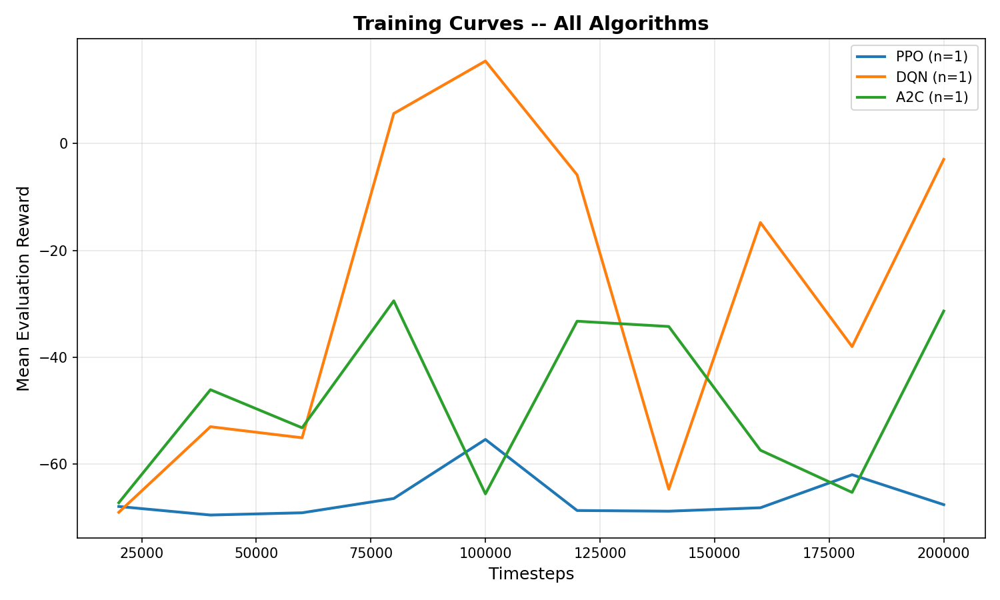
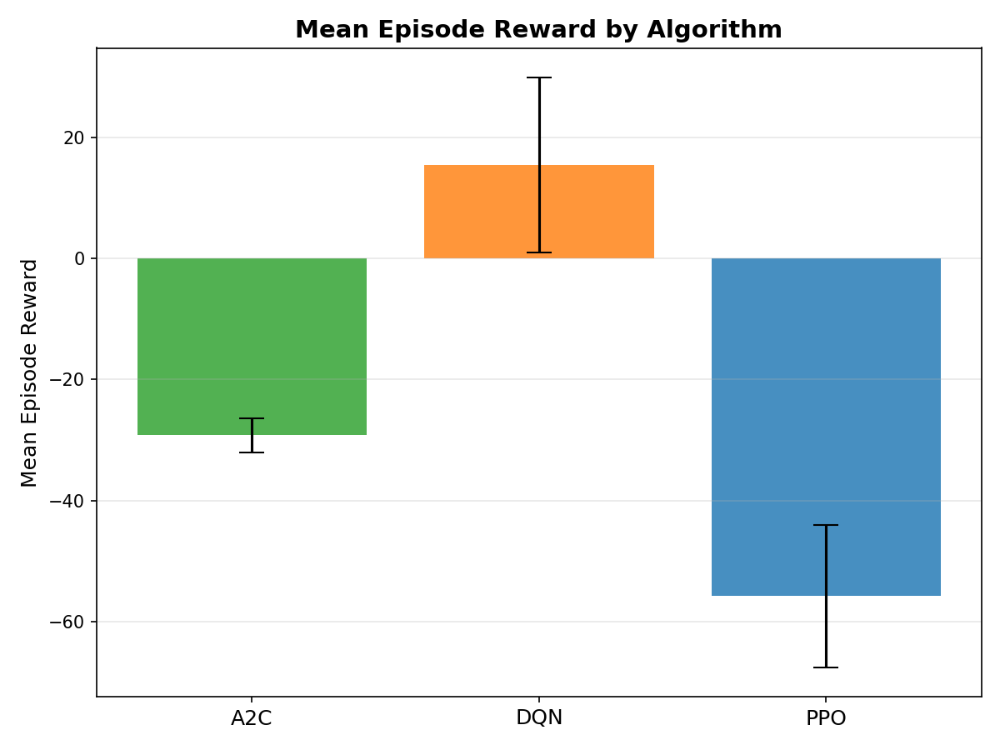
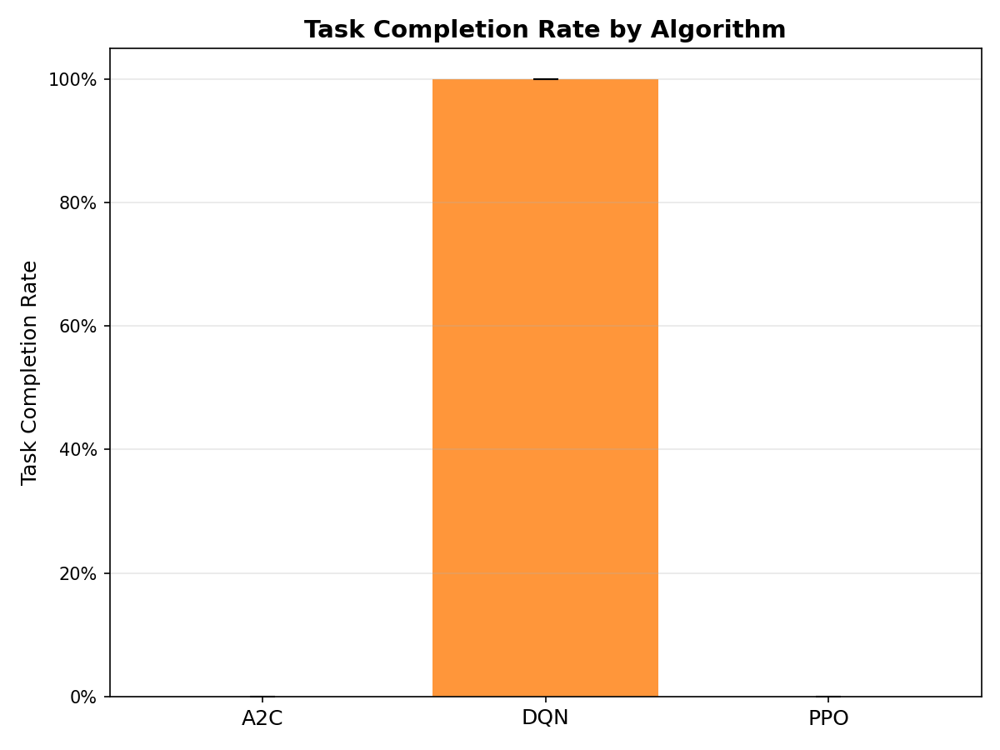
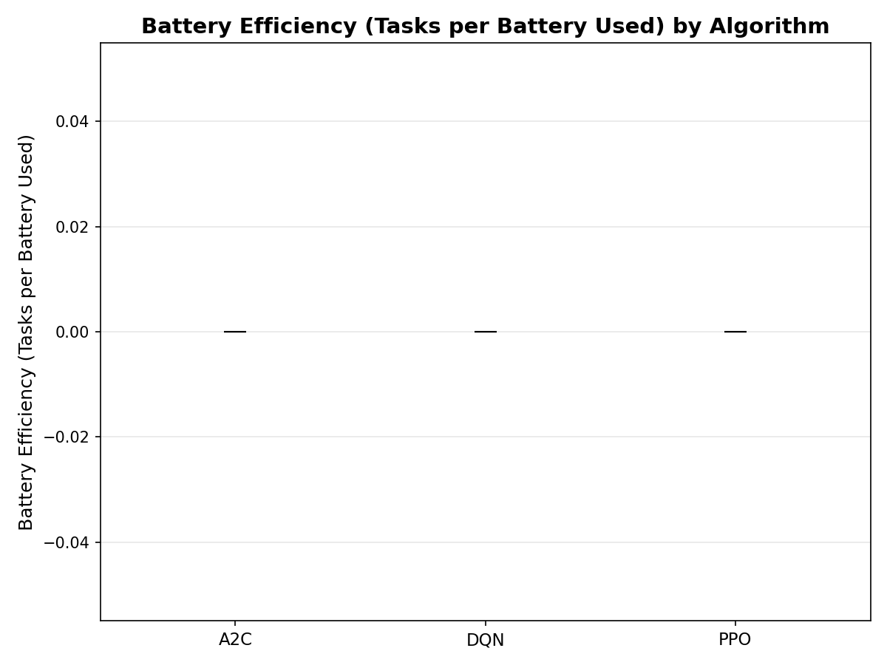

# OfficeBot RL

> A reproducible reinforcement-learning benchmark for an autonomous office assistant.

OfficeBot RL trains and compares **PPO**, **DQN**, and **A2C** agents in a 15 x 15 office grid.
The robot must navigate around furniture, complete delivery and meeting tasks, and manage a
limited battery while avoiding collisions.

[](https://www.python.org/)
[](https://gymnasium.farama.org/)
[](https://stable-baselines3.readthedocs.io/)
[](https://pytest.org/)

## What the agent learns

- Navigate a fixed office layout with obstacles and corridors.
- Choose from six discrete actions: turn, move, pick up, deliver, and interact.
- Complete coffee, document, and meeting tasks.
- Return to the charging station when battery is critically low.
- Trade off short-term movement rewards against delayed task and battery rewards.

## Results at a glance

The table below is the checked-in comparison from 200,000 training steps per algorithm and
50 deterministic evaluation episodes (seed 42). It is intentionally reported as-is: DQN
learned the current task reliably, while PPO and A2C need more training or curriculum learning.

| Metric | A2C | DQN | PPO |
|---|---:|---:|---:|
| Mean episode reward | -29.24 | **15.41** | -55.75 |
| Task completion rate | 0% | **100%** | 0% |
| Mean episode length | 369.5 | 500.0 | 453.9 |
| Mean collisions | 0 | 0 | 0 |
| Mean battery remaining | 0% | **58%** | 0% |
| Battery efficiency | 0.00 | **2.76** | 0.00 |

> **Interpretation:** “Task completion rate” measures completion of the first queued task in
> this experiment. The all-tasks success rate remains 0% because episodes time out before all
> five tasks are completed.

## Visual results

### Training curves



### Algorithm comparison

<p align="center">
  
  
</p>

<p align="center">
  
</p>

These figures are generated from the tracked experiment outputs in `results/`. The source
plots remain reproducible with `python -m visualization.plot_results`.

## Quick start

### 1. Install

```bash
git clone https://github.com/rajsekharrr/officebot--rl.git
cd officebot--rl
python -m venv .venv

# Windows PowerShell
.venv\Scripts\Activate.ps1

# macOS/Linux
# source .venv/bin/activate

python -m pip install --upgrade pip
python -m pip install -r requirements.txt
```

### 2. Verify the environment

```bash
python -m pytest tests/test_smoke.py -q
```

### 3. Run a trained-model demo

```bash
# Opens the pygame visualisation
python run_demo.py --algo dqn --seed 42 --episodes 3 --speed 15

# Works on headless machines and CI
python run_demo.py --algo dqn --seed 42 --episodes 3 --headless
```

### 4. Evaluate and regenerate plots

```bash
python -m evaluation.evaluate --algo dqn --seed 42 --episodes 50
python -m evaluation.compare
python -m visualization.plot_results
```

### 5. Train a new agent

```bash
python -m training.train --algo ppo --seed 42 \
  --config configs/ppo_config.yaml --timesteps 200000
```

Replace `ppo` and the config path with `dqn` or `a2c` to train another algorithm.

## How it works

```text
Observation (53 values)
        |
        v
OfficeBotEnv (15 x 15 grid, tasks, obstacles, battery)
        |
        v
PPO / DQN / A2C policy
        |
        v
Action -> transition -> reward -> next observation
```

The custom Gymnasium environment combines MiniGrid objects with task queues, collision
penalties, movement costs, task rewards, battery depletion, and charging behavior. Stable-
Baselines3 supplies the reference implementations and model serialization.

## Repository layout

```text
agents/          Algorithm factory and model loading
configs/         Environment and algorithm YAML configuration
environment/     Office grid, objects, constants, and task logic
evaluation/      Episode evaluation and cross-algorithm comparison
training/        Training entry point and metric callbacks
visualization/   Reproducible result plots
tests/           Environment, reward, agent, and integration tests
models/          Local trained checkpoints (ignored; regenerate or download separately)
logs/            Local TensorBoard and metric logs (ignored)
results/         Tracked CSV/JSON experiment summaries
docs/images/     Curated plots displayed in this README
```

## Documentation

- [Project documentation](PROJECT_DOCUMENTATION.md) - implementation, environment, and experiment details
- [How to demo](HOW_TO_DEMO.md) - a short presentation script and TensorBoard walkthrough
- [Evaluation guide](EVALUATION_GUIDE.md) - evaluation and comparison commands
- [Training verification](TRAINING_VERIFICATION.md) - checks for trained models and metrics
- [Algorithm explanations](ALGORITHM_EXPLANATIONS.md) - PPO, DQN, and A2C in this project

## Known limitations and next steps

- PPO and A2C do not yet complete tasks reliably at 200,000 steps.
- The current comparison uses one evaluation seed; multi-seed confidence intervals are a natural next step.
- The layout is fixed (`randomise_layout: false`), so policies can overfit to this map.
- Human rendering requires a display; use `--headless` on servers and CI.
- Longer training, curriculum learning, layout randomisation, and a stronger multi-task evaluation
  would make the benchmark more robust.

## License

No license file is currently included. Add a license before redistributing the project.
